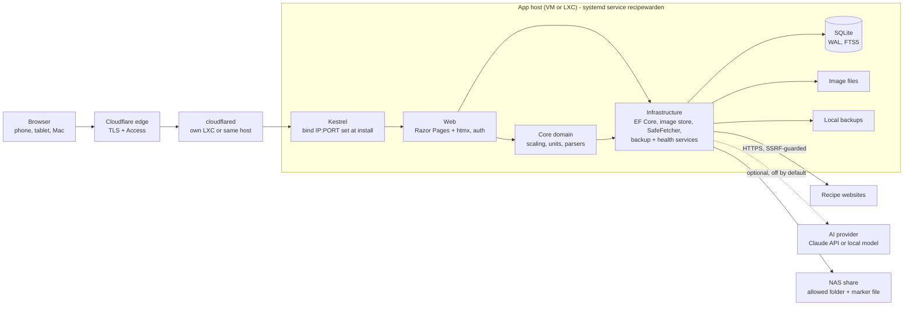

# RecipeWarden — Specification v0.12

Version 0.12 · 2026-11-22

## 1. Overview

A self-hosted, single-household recipe manager, RecipeWarden, built on .NET 10 / C# and SQLite. It runs as a systemd service on a headless Linux server, and it is reached securely over a Cloudflare Tunnel. Cloudflare Access limits the site to the household, and reading needs no app sign-in; adding, editing and deleting require sign-in.

**Working name:** RecipeWarden (D-01).

### 1.1 Goals

1. Bring recipes in from anywhere — typed in, imported from a URL, or uploaded as Markdown, Word (.docx) or PDF — and normalize them into one structured format.
2. Make recipes easy to cook from: scaling, conversions to measures the household can actually make with the tools it owns, cook mode, printing.
3. Keep the collection organized and findable: tags, custom lists (collections), full-text search, a useful home page.
4. Be safe to expose on the internet: secure by default, hardened service, tested every build.
5. Be easy to own: one-command install and upgrade, scheduled backups with retention, one-click restore.

### 1.2 Non-goals (v1)

- Multi-tenant or public sign-up. There is one household; accounts are created by an admin.
- Native mobile apps. The site is responsive and installable as a PWA-lite (home-screen icon) only.
- Meal planning calendars, pantry inventory tracking and grocery delivery integrations (candidates for v2).
- OCR of scanned/image-only PDFs (text-based PDFs only in v1; see D-07).

### 1.3 Glossary

| Term | Meaning |
| --- | --- |
| Canonical recipe | The unified internal structure every recipe is converted to on import or entry. |
| Kitchen inventory | The user-maintained list of measuring tools, scales, thermometers and appliances on hand. |
| Inventory version | A counter that increments whenever the kitchen inventory changes; used to detect new tool suggestions. |
| Vague quantity | A non-numeric amount such as pinch, dash, smidgen, "to taste", "a handful". |
| Yield conversion | Mapping between a prepared state and a purchase state, e.g. cooked shredded chicken → raw boneless chicken. |
| Display plan | The per-ingredient decision of which unit and which tool to show after scaling and conversion. |
| Collection | A user-curated, named list of recipes ("Weeknight", "Holiday baking"). |
| Variant | A saved copy of a recipe derived from another (e.g. a saved 2x version), linked to its parent. |

## 2. Decisions

All twelve decisions were settled on 2026-11-17, and the spec reflects them. Any change goes through an ADR in docs/adr/.

| ID | Decision | Outcome |
| --- | --- | --- |
| D-01 | Product name | RecipeWarden. Code namespace `RecipeWarden.*`; service, user, CLI and paths `recipewarden`. |
| D-02 | Read exposure | Cloudflare Access limits the whole site to household emails; the app itself needs no sign-in to read (SEC-64). |
| D-03 | UI framework | Razor Pages + htmx. |
| D-04 | Accounts | Admin + Editor roles; Admin creates accounts; no self sign-up. |
| D-05 | Deployment style | Self-contained linux-x64 build (arm64 Should); installer installs OS packages only. |
| D-06 | Nutrition data | Bundled USDA FoodData Central dataset, fully offline. Gaps are filled by the unmatched-ingredient report and mapping, custom foods from package labels, and dataset refresh (FR-NUT-03 to 05). No online lookup. |
| D-07 | Scanned PDFs | Text PDFs only in v1; OCR later. |
| D-08 | AI-assisted parsing | Optional AI parser in v1, off by default: Claude API or any OpenAI-compatible endpoint, including a local model (FR-IMP-09/10, SEC-44 to 47). |
| D-09 | Default unit system | US customary with per-user override; weights offered when a scale is in inventory. |
| D-10 | Shopping lists | Signed-in users create and delete lists; anyone on the site can view and check items off. |
| D-11 | Image library | SkiaSharp (MIT). |
| D-12 | Backup destinations | PennyWarden model: the server owner mounts storage and lists allowed folders in config; `recipewarden apply-config` opens them in the service sandbox; each schedule writes to one listed folder (e.g. daily to local disk, weekly to the NAS share). Off-site copies happen outside the app (FR-BKP-08 to 15). |

PennyWarden's backup-destination requirements are adopted (sections 3.11, 4.7, 9.6). If other PennyWarden specs (installer, auth, logging) are added to the project, this spec defers to them where they overlap, unless a rule here is stricter.

## 3. Requirements

Requirements carry stable IDs (FR = functional, NFR = non-functional) used by the traceability matrix, tests and commit messages. Priority uses MoSCoW: M = Must (v1), S = Should (v1 if time allows), C = Could (later).

### 3.1 Recipe content (REC)

| ID | Requirement | Pri |
| --- | --- | --- |
| FR-REC-01 | Store per recipe: title, description, tags, finish image, ingredients (optionally in named groups), ordered steps with optional step images, nutrition, allergen alerts, servings/yield, prep/cook/total time, notes, source attribution. | M |
| FR-REC-02 | Create, edit and delete recipes through a web form, with drag-to-reorder for ingredients and steps. | M |
| FR-REC-03 | Parse each typed ingredient line ("1 1/2 cups flour, sifted") into quantity, range, unit, ingredient, preparation and optional flag, while keeping the original text. | M |
| FR-REC-04 | Deleted recipes go to a trash and can be restored for 30 days before purge. | S |
| FR-REC-05 | Save a scaled or edited copy as a variant linked to its parent. | S |
| FR-REC-06 | Mark a recipe as baking/precision so conversions and rounding use tighter tolerances. | M |
| FR-REC-07 | Track last cooked date and a personal rating (1–5) and notes per recipe. | S |

### 3.2 Import (IMP)

| ID | Requirement | Pri |
| --- | --- | --- |
| FR-IMP-01 | Import from a URL: read schema.org Recipe JSON-LD first, then microdata, then a heuristic HTML fallback. | M |
| FR-IMP-02 | On URL import, offer an opt-in checkbox to copy the source's finish image. | M |
| FR-IMP-03 | Every imported public recipe stores source name, author (if given), URL and import date, and displays credit with a direct link. | M |
| FR-IMP-04 | Import from structured Markdown in the app's defined format (recipe-md v1, section 9.7), and from loosely structured Markdown by heading detection. | M |
| FR-IMP-05 | Import from Word .docx (headings/lists detected) and text-based PDF. | M |
| FR-IMP-06 | Every import goes through a review screen showing parsed fields, warnings and low-confidence lines before saving. | M |
| FR-IMP-07 | Detect likely duplicates (same source URL, or same normalized title + ingredient overlap above 80%) and offer open existing / save anyway. | S |
| FR-IMP-08 | Keep the raw import payload for 30 days to allow re-parsing after parser fixes. | C |
| FR-IMP-09 | Optional AI parser (D-08), off by default and enabled by an Admin: provider Claude API or any OpenAI-compatible endpoint (including a local model such as Ollama or LM Studio), model name and API key. Used automatically when the rules-based parse finds no structure or many low-confidence lines (e.g. blog prose, messy PDFs), or on demand with "Re-parse with AI" on the review screen. Output must validate as recipe-md v1 and always goes to review, with AI-parsed fields marked. | M |
| FR-IMP-10 | AI usage visibility: a log of each call (provider, model, tokens in/out, duration, result), a monthly token total on the admin dashboard, a "Test connection" button, and an optional monthly token cap after which AI parsing pauses and the rules-based parser is used. | S |

### 3.3 Organization and search (ORG / SRCH)

| ID | Requirement | Pri |
| --- | --- | --- |
| FR-ORG-01 | Tags are free-form but de-duplicated case-insensitively; tags can be typed (Meal, Course, Season, Method, Cuisine, Diet) for grouped filtering. A built-in set (ADR 0011) is seeded once, including "Homemade Ingredient" for recipes made to be used in other recipes; editors can rename, delete or add tags. | M |
| FR-ORG-02 | Custom lists (collections) can be created, ordered and populated by editors; visible to all readers. | M |
| FR-SRCH-01 | Full-text search across title, description, ingredients, steps, tags and notes with ranked results. | M |
| FR-SRCH-02 | Filters: tags, collection, max total time (the high end of a time range must fit, ADR 0010), "free of" allergens, has image, rating; sort by relevance, newest, title, last cooked. | M |
| FR-SRCH-03 | Search "by ingredients on hand": rank recipes by how many listed ingredients they use. | S |

### 3.4 Display, print and export (VIEW / EXP)

| ID | Requirement | Pri |
| --- | --- | --- |
| FR-VIEW-01 | Reading view: image, meta, allergen badges, ingredients, steps, nutrition, source credit. | M |
| FR-VIEW-02 | Cook mode: large type, tap-to-check ingredients and steps, keeps the screen awake (Wake Lock API), tap-to-start timers detected in step text. | S |
| FR-EXP-01 | Print layout: one column, ingredients before steps, no navigation, fits on as few pages as possible, prints current scale and unit choices, prints source credit and URL. | M |
| FR-EXP-02 | Export a recipe to the defined Markdown format (YAML front matter + fixed sections); images exported alongside in a .zip when chosen. | M |
| FR-EXP-03 | Bulk export of all recipes (or a collection) to a .zip of Markdown files + images. | S |
| FR-EXP-04 | "Export for AI" for one recipe, a collection or all recipes: one Markdown file (download or copy to clipboard) containing an instruction header that explains recipe-md v1 and asks the AI to reply in the same format, a chosen goal (improve flavour, healthier, cheaper, adapt to my tools, make-ahead/freezer, clarify steps, or custom text), optionally the kitchen inventory and unit preferences, then the recipe(s) in recipe-md v1. | C |
| FR-EXP-05 | "Import AI response": paste or upload the AI's reply; the app extracts recipe-md blocks, validates them, shows a field-by-field diff against the original, and saves as a linked variant (default) or, for Editors, as an update to the original. | M |
| FR-EXP-06 | Publish a JSON Schema for recipe-md v1 front matter at /docs/recipe-md.schema.json so AI agents and tools can validate their output. | S |
| FR-EXP-07 | Prompt builder in Export for AI: an optional "Why are you taking this to AI?" step where the user picks one or more goals from the catalogue (section 4.9), fills each goal's details (e.g. which flavour to reduce, which component to increase and by how much), adds what happened last time and any constraints, and gets a suggested prompt in an editable preview. Copy options: prompt only, or prompt + recipe file. | C |
| FR-EXP-08 | Editors can edit the built-in goal templates and save custom ones; each recipe keeps a history of prompts generated for it, so a past prompt can be reused or refined. | C |

### 3.5 Scaling and measurement intelligence (SCL / MEAS)

| ID | Requirement | Pri |
| --- | --- | --- |
| FR-SCL-01 | Scale presets 0.5x, 1x, 1.5x, 2x, 3x, plus custom factor (0.1x–100x) and "target servings". | M |
| FR-SCL-02 | Scale from one ingredient ("I have 3 lb chicken") to derive the factor. | S |
| FR-SCL-03 | Scaling never changes the stored recipe; it changes the view, print and export only. | M |
| FR-MEAS-01 | Convert between volume, weight and count units using unit factors plus a per-ingredient density table. | M |
| FR-MEAS-02 | Round every scaled amount to a measure makeable with the tools in the kitchen inventory, e.g. 0.6 cup → "1/2 cup + 1 1/2 Tbsp", or 113 g on a 1 g scale. | M |
| FR-MEAS-03 | Resolve vague quantities to an approximate amount (pinch ≈ 1/16 tsp, dash ≈ 1/8 tsp, smidgen ≈ 1/32 tsp) and show the nearest available tool; amounts below the smallest tool scale as "pinch" counts. | M |
| FR-MEAS-04 | Resolve prepared-state ingredients to purchase state using yield conversions, e.g. "4 cups cooked shredded chicken → about 1 3/4–2 lb raw boneless chicken", shown as a helper note. | M |
| FR-MEAS-05 | Users can view and edit densities, vague-quantity values and yield conversions. | S |
| FR-MEAS-06 | Count items scale sensibly: eggs round to whole or half with a note ("2 eggs + 1 yolk"); cans and packages show "1 can (15 oz) + about 1/3 more". | M |
| FR-MEAS-07 | Temperatures display in °F or °C by preference; pan sizes suggest alternatives when scaled (area-based). | S |
| FR-SCL-04 | Scale to fit a container: pick a container from My Kitchen (e.g. 16 oz squeeze bottle) or type a capacity, and the app derives the factor so the finished recipe fills it, allowing for headspace (fill %). Shows the factor, expected fill ("about 14.4 of 16 fl oz") and the scaled ingredients. | M |
| FR-SCL-05 | Multiple containers and the reverse question: "fill 3 bottles" sets the factor for all three; "how many will this make?" shows container count at the current scale ("1 full bottle + about 2/3 of another"). | M |
| FR-SCL-06 | Recipes store a finished yield amount (volume or weight) with its source: measured, entered or estimated. After cooking, the app asks "How much did it make?" so container scaling gets more accurate over time. | M |

### 3.6 Kitchen inventory (TOOL)

| ID | Requirement | Pri |
| --- | --- | --- |
| FR-TOOL-01 | Maintain a kitchen inventory: measuring spoons and cups (each size), liquid measures, scales (units supported and resolution), thermometers, appliances, pans (size), and storage/serving containers (squeeze bottles, jars, tubs, freezer containers) with capacity, default fill % and how many are owned. | M |
| FR-TOOL-02 | Add, edit, retire and re-activate tools at any time; retired tools are kept for history. | M |
| FR-TOOL-03 | All display plans (FR-MEAS-02) use only active tools. | M |
| FR-TOOL-04 | When a recipe is opened and the inventory has changed since that recipe last evaluated suggestions, show applicable suggestions (e.g. "You now have a scale — show flour by weight?", "New 1/8 tsp spoon replaces 'scant 1/4 tsp'", "Instant Pot added — pressure-cook variation available"). | M |
| FR-TOOL-05 | Suggestions can be applied (to the view, or saved to the recipe by an editor) or dismissed per recipe; dismissed suggestions do not return unless the inventory changes again in a way that creates a new suggestion. | M |

### 3.7 Shopping list (SHOP)

| ID | Requirement | Pri |
| --- | --- | --- |
| FR-SHOP-01 | Create a shopping list from one or more recipes at chosen scales. | M |
| FR-SHOP-02 | Merge like ingredients across recipes with unit conversion (1 cup + 4 Tbsp butter → 1 1/4 cups / 10 oz); use purchase state from yield conversions. | M |
| FR-SHOP-03 | Group items by store section; manual items can be added; items can be checked off; pantry staples are excluded by default and listed separately. | M |
| FR-SHOP-04 | Print a shopping list and export it as plain text/Markdown. | S |

### 3.8 Nutrition and allergens (NUT / ALG)

| ID | Requirement | Pri |
| --- | --- | --- |
| FR-NUT-01 | Show per-serving nutrition (calories, fat, saturated fat, cholesterol, sodium, carbohydrate, fibre, sugar, protein) labelled with its source: imported, calculated or manual. | M |
| FR-NUT-02 | Calculated nutrition shows a completeness % (share of ingredients matched) and is recalculated when ingredients change. | M |
| FR-ALG-01 | Detect the nine major US allergens (milk, egg, fish, crustacean shellfish, tree nuts, peanuts, wheat, soy, sesame) plus gluten from ingredients, and show badges. | M |
| FR-ALG-02 | Editors can add or override allergen flags; overrides are marked as manual. | M |
| FR-ALG-03 | Show a standing disclaimer that allergen and nutrition data are estimates. | M |
| FR-NUT-03 | Unmatched-ingredient report: lists ingredients with no nutrient mapping, ranked by how many recipes use them; an Editor maps each to a food in the bundled USDA data by search (e.g. "gochujang" → hot chile paste). A mapping applies to every recipe using that ingredient and triggers recalculation. | M |
| FR-NUT-04 | Custom foods from a package label: enter serving size (g or ml) and the Nutrition Facts values; the app stores them per 100 g as a local food that can be mapped like any USDA food. | M |
| FR-NUT-05 | Dataset refresh: each release ships the current USDA snapshot; an Admin can also import a newer USDA FoodData Central download file (uploaded, never fetched by the app). Mappings are kept by USDA id; foods removed from the new dataset are flagged for re-mapping. | M |
| FR-NUT-06 | When the AI parser is enabled, it can suggest mappings for unmatched ingredients, choosing only from candidate foods found in the local dataset; an Editor confirms each suggestion. | S |

### 3.9 Home, navigation and preferences (HOME / UI)

| ID | Requirement | Pri |
| --- | --- | --- |
| FR-HOME-01 | Home page shows: search, recommended recipes, recently added, collections, and browse-by-tag. | M |
| FR-HOME-02 | Recommendations are rule-based: season tags matching the current month, highly rated not cooked in 60+ days, recently added, favorites. | S |
| FR-UI-01 | Light, dark and system themes; choice persists across sessions for anonymous visitors (cookie) and signed-in users (profile). | M |
| FR-UI-02 | Unit system and default scale preferences persist the same way. | S |

### 3.10 Accounts and administration (AUTH / ADM)

| ID | Requirement | Pri |
| --- | --- | --- |
| FR-AUTH-01 | Reading, searching, printing and exporting recipes require no sign-in. | M |
| FR-AUTH-02 | Creating, editing, deleting and importing recipes, and managing tags, collections and inventory, require sign-in with the Editor or Admin role. | M |
| FR-AUTH-03 | Settings, users, backups and restore require the Admin role. | M |
| FR-AUTH-04 | Optional TOTP two-factor authentication per account. | S |
| FR-ADM-01 | Audit log of every write: who, what, when, from which IP. | M |

### 3.11 Backup and restore (BKP)

| ID | Requirement | Pri |
| --- | --- | --- |
| FR-BKP-01 | On-demand backup of database + images + config into one archive with a manifest and checksum. | M |
| FR-BKP-02 | Scheduled backups (cron expression or simple daily/weekly picker); several schedules allowed, each writing to one allowed folder (e.g. daily to local disk, weekly to the NAS share). | M |
| FR-BKP-03 | Retention rules: keep last N, plus daily/weekly/monthly tiers (grandfather-father-son). | M |
| FR-BKP-04 | Restore from a listed backup or uploaded archive, after validation, with an automatic pre-restore backup. | M |
| FR-BKP-05 | Run now, and a run history (time, schedule, destination, result, file, size, error); status and failures shown on the admin dashboard; schedule changes audited. | S |
| FR-BKP-06 | Restore at initialization: a fresh install can start from a backup instead of empty, either with install.sh --restore \<archive> or from the first-run setup page ("Start new" or "Restore from backup"). Used to move to a new host with more resources. | M |
| FR-BKP-07 | Ad hoc restore at any time from the web UI (Admin) or from the server shell with recipewarden restore \<archive>, which works even when the web UI is down; the CLI stops the service, restores, migrates and restarts it. | M |
| FR-BKP-08 | Allowed backup folders (PennyWarden BKP-CFG-001 to 003): the config file lists folders the app may write backups to (Backup:AllowedFolders), empty by default except the built-in local backup folder. Each entry must be an absolute path without control characters, outside /home, /root and /run/user (rejected with the reason), and a folder if it exists; a missing folder is a warning, not an error. Duplicates and trailing slashes are normalized. Only the server owner edits the list. | M |
| FR-BKP-09 | sudo recipewarden apply-config (BKP-SVC-001): validates config without stopping anything; writes /etc/systemd/system/recipewarden.service.d/backup-folders.conf with one ReadWritePaths="-\<folder>" line per folder (removes it when the list is empty); never edits override.conf; daemon-reload, restart, wait for health, and restore the previous drop-in if health fails; prints what changed; audits before/after folders and the OS user; supports --dry-run and --no-restart. The installer calls the same command. | M |
| FR-BKP-10 | Destination from config, never from the request (BKP-APP-001/002): the schedule screen offers only listed folders and saves the matching config entry; with no folders listed it explains how to add one and run apply-config. | M |
| FR-BKP-11 | Test button (BKP-APP-003): writes and deletes .recipewarden-write-test-\<random> in the chosen folder and reports success or the OS error with a hint ("Read-only file system" = run apply-config or restart; "Permission denied" = mount ownership). | M |
| FR-BKP-12 | Mount check (BKP-APP-009): before every run and Test, the folder must contain the marker file .recipewarden-backup-target created by the server owner; if missing, fail with "The backup folder is not mounted or is the wrong location" and write nothing. | M |
| FR-BKP-13 | Atomic writes (BKP-APP-004): write .\<name>.partial in the destination, then rename; remove the partial file on failure. | M |
| FR-BKP-14 | Failure handling (BKP-APP-006): record the failed run, show Admins a banner, retry with backoff of 1, 2, 4 … hours (max 24); the next scheduled run still happens on time; a run missed while the app was stopped runs at the next start. | M |
| FR-BKP-15 | Encrypted backups (BKP-APP-008): archives are encrypted before leaving the server with a key pair created at setup. The app keeps only the public key; the private key is protected by a passphrase and given to the Admin once as a downloadable recovery kit. Restore (web, CLI or install --restore) asks for the kit and passphrase. | M |

### 3.12 Installation and operations (INST / OPS)

| ID | Requirement | Pri |
| --- | --- | --- |
| FR-INST-01 | A single install script installs missing dependencies, installs the app, creates a service user, configures and enables a systemd service that starts at boot. | M |
| FR-INST-02 | Install accepts the listening port and bind address (loopback, a specific host IP such as 192.168.1.15 for a tunnel on another container or VM, or all interfaces), both changeable later without reinstalling; it refuses a port already in use and suggests the next free one. | M |
| FR-INST-03 | The same script upgrades in place (with a pre-upgrade backup) and uninstalls (keeping data unless `--purge`). | M |
| FR-INST-04 | The installer creates the first admin account interactively, or from a one-time setup token shown in the console. | M |
| FR-OPS-01 | Health endpoint for monitoring; structured logs to journald and rolling files. | M |
| FR-OPS-02 | Admin health page: overall status; database size, WAL size, reclaimable free pages, last integrity check result and time, schema version, record counts; data volume total, used and free; space by category (database, images, import cache, backups, logs); backup volume free space and reachability; last successful backup age; app version, uptime, memory. | M |
| FR-OPS-03 | Capacity tracking: a daily storage snapshot drives a 90-day growth chart and a "days until full" projection; configurable Warning and Critical thresholds raise a banner for Admins on every page and a clear recommendation (free space, add disk, or back up and restore to a larger host). | M |
| FR-OPS-04 | Maintenance actions on the health page: run integrity check, VACUUM (compact) the database, purge expired import files and trash, open the "move to a new host" guide. | S |
| FR-OPS-05 | Machine-readable status: /health/ready returns 503 when status is Critical (for Uptime Kuma or similar); optional outbound webhook (e.g. ntfy, Discord) on status change. | S |

### 3.13 Non-functional

| ID | Requirement |
| --- | --- |
| NFR-01 Performance | Recipe and home pages render server-side in under 300 ms at p95 with 5,000 recipes on a 2-vCPU host; search returns in under 200 ms. |
| NFR-02 Footprint | Idle memory under 250 MB; runs on Debian 12/13 and Ubuntu 22.04/24.04/26.04 LTS x64 (arm64 a Should). |
| NFR-03 Accessibility | WCAG 2.2 AA: keyboard reachable, visible focus, 4.5:1 contrast in both themes, labelled forms, alt text on images. |
| NFR-04 Browsers | Current Safari (macOS/iOS), Chrome, Firefox, Edge; responsive from 360 px to desktop ultrawide (3440 px). |
| NFR-05 Security | Meets every rule in section 5; no high/critical vulnerable packages at release. |
| NFR-06 Quality | Every test passes on every build; line coverage at least 90% and branch coverage at least 85% in Core; 80% overall. |
| NFR-07 Reliability | SQLite in WAL mode; no data loss on service restart; backups verified by restore test in CI. |
| NFR-08 Maintainability | Warnings as errors, nullable enabled, analyzers on, central package management. |
| NFR-09 Privacy | No telemetry, no third-party scripts, fonts or CDNs; all assets served locally. |

## 4. Business rules

These rules are enforced in the domain layer (not only the UI) and each has unit tests.

### 4.1 Recipe data

| ID | Rule |
| --- | --- |
| BR-01 | A published recipe needs a title (1–200 chars), at least one ingredient and at least one step. Imports that miss these save as Draft. |
| BR-02 | Slugs are generated from the title and are unique. A published URL never stops working: when a published recipe's title changes, the slug follows it and every earlier published slug redirects (301) to the current one (ADR 0008). |
| BR-03 | Servings must be a positive number or a range of them ("6-8", ADR 0010; the high end above the low end); if unknown, the recipe defaults to 4 and is flagged "servings estimated". |
| BR-04 | The original ingredient text is always kept alongside parsed fields; a parse with confidence below 0.8 is flagged for review. |
| BR-05 | Deleting sends a recipe to trash; purge after 30 days is automatic; only Admin can purge immediately. |
| BR-06 | Concurrent edits are detected with a row version; the second save is rejected with a "changed by someone else" message and a diff. |

### 4.2 Attribution and imports

| ID | Rule |
| --- | --- |
| BR-10 | A recipe with source type Web must have a source URL and a display name; credit and link show on reading view, print and export, and cannot be hidden. |
| BR-11 | Only an Admin can change a Web recipe's source type to another type, e.g. Personal when heavily adapted (any change away from Web, so the credit cannot be hidden by another route), and the change is audit-logged. |
| BR-12 | Copying a source image requires the user to tick the opt-in on that import; the image's original URL is stored with it. |
| BR-13 | Imported HTML is never stored or rendered as HTML: text is extracted and stored as plain text or restricted Markdown. |

### 4.3 Scaling and conversion

| ID | Rule |
| --- | --- |
| BR-20 | Scaling multiplies quantity (and range max) by the factor, then the display planner picks a unit and tool combination. |
| BR-21 | Rounding tolerance: ±2% for baking/precision recipes, ±8% otherwise. The planner never exceeds 3 tool fills per ingredient ("1 cup + 2 Tbsp + 1 tsp"). |
| BR-22 | Weight is preferred over volume when (a) an active scale exists, (b) a density is known, and (c) the recipe is baking or the ingredient is a dry solid; the original volume shows as a secondary line. |
| BR-23 | Volume↔weight conversion is only offered when a density exists for that ingredient; otherwise the original unit is kept and no guess is made. |
| BR-24 | Unit escalation: amounts move to the next larger unit when they would need more than the tool cap (e.g. 16 Tbsp → 1 cup; 48 tsp → 1 cup). |
| BR-25 | Vague quantities keep their word in the text ("pinch salt") and show the approximate amount as a hint; scaled vague amounts above 4 pinches convert to the nearest tool. "To taste" never scales. |
| BR-26 | Yield conversions are shown as an "about" range with the basis ("boneless breast, \~25% cooking loss"), never as an exact amount. |
| BR-27 | Count items: round to the nearest whole; eggs round to the nearest half and express halves as "+ 1 yolk" in ordinary recipes, or "4½ eggs (4 eggs + 2 Tbsp beaten egg)" in baking/precision recipes (ADR 0012). |
| BR-28 | Fractions display with denominators 2, 3, 4, 8 only (and 16 for tsp); decimals for metric (1 decimal for g under 10 g, whole g otherwise; ml whole). |
| BR-29 | Times are not scaled automatically; a note warns that cook times may change for scaled recipes above 2x or pan changes. |
| BR-110 | Container factor = (container capacity × fill % × container count) ÷ finished yield, both in ml. Default fill %: 90% for bottles and jars, 85% for freezer containers (expansion), 100% for serving dishes; editable per container and per use. |
| BR-111 | Container scaling needs a finished yield. If none is stored, the user can enter one, or the app estimates it from the sum of ingredient volumes it can convert, listing the ingredients it could not include and labelling the result "estimate". Precedence: measured > entered > estimated. |
| BR-112 | A weight-based yield can fill a volume container only if a finished-product density is entered; otherwise the option explains what is missing instead of guessing. |
| BR-113 | After the display planner rounds amounts (BR-21, BR-27), expected fill is recalculated; if rounding moves the yield more than 5% from the target, the result warns ("rounding eggs puts you about 7% over: may overflow"). |
| BR-114 | Requesting more containers than are owned is allowed but noted ("you have 2; this needs 3"). Container scaling is a view like any scale (BR-20, FR-SCL-03) and can be printed, exported or added to a shopping list. |

### 4.4 Kitchen inventory and suggestions

| ID | Rule |
| --- | --- |
| BR-30 | Any add, retire or edit of a tool increments the inventory version. |
| BR-31 | Each recipe stores the inventory version at which suggestions were last accepted (`InventoryVersionSeen`). On view, suggestions are re-evaluated in memory against the snapshot at that version; viewing never writes (SEC-31, ADR 0017). Measures (spoons, cups) apply at once; a new scale is offered as weights. Dismissing or applying needs Editor and moves the stored version. |
| BR-32 | A suggestion is shown only if it changes at least one displayed amount, tool or method, and it is keyed (e.g. `scale:flour`) so a dismissal is remembered per recipe. |
| BR-33 | If no measuring tools are in the inventory, the planner assumes a standard US set (1/4, 1/2 and 1 tsp; 1 Tbsp; 1/4, 1/3, 1/2 and 1 cup) and says so. |

### 4.5 Shopping lists

| ID | Rule |
| --- | --- |
| BR-40 | Items merge only when the ingredient matches and units are convertible; otherwise they list as separate lines under the same ingredient. |
| BR-41 | Merged quantities round up to purchasable amounts where a package size is known (e.g. butter in 1/2 cup sticks). |
| BR-42 | Each item keeps links to the recipes it came from. |

### 4.6 Nutrition and allergens

| ID | Rule |
| --- | --- |
| BR-50 | Nutrition precedence: manual > imported > calculated. Calculated nutrition with completeness below 70% displays as "partial". |
| BR-51 | Nutrition is per serving and unchanged by scaling (servings scale with it). |
| BR-52 | Allergen detection uses the ingredient catalogue mapping plus keyword rules; manual overrides win and survive re-detection. |
| BR-53 | (M6, ADR 0009) A "free of" filter excludes any recipe with that allergen detected or manually set, and also recipes with unmatched ingredients unless the user chooses "include unverified". |
| BR-54 | Nutrition data is local only: the app never calls a nutrition service. Mapping precedence for an ingredient: Editor mapping > custom food > automatic name/alias match. Unmapped ingredients lower completeness (BR-50) and appear in the unmatched report. |

### 4.7 Backups

| ID | Rule |
| --- | --- |
| BR-60 | A backup is a consistent snapshot: SQLite online backup (not a file copy) plus images, config and a manifest with app version, schema version and SHA-256 of each part. |
| BR-61 | Retention deletes only files that its own successful runs recorded in that folder (never by name pattern, never other files on the share), and never deletes the most recent successful backup or any pre-restore/pre-upgrade backup younger than 30 days. |
| BR-62 | Restore only accepts archives whose manifest validates, whose checksums match, which decrypt with the supplied recovery kit and passphrase, whose schema version is equal or older (then migrated), and whose database passes `PRAGMA integrity_check`. |
| BR-63 | During restore the site shows a maintenance page; writes are blocked. |

Additional restore rules:

| ID | Rule |
| --- | --- |
| BR-64 | Restore at initialization applies the same validation as BR-62. Recipes, images, users, tool inventory and app settings come from the archive; network settings (bind IP, port, trusted proxy, allowed IPs) always come from the new install, so a host move with a new IP works without editing config. |
| BR-65 | Archives from a newer app version are refused with the message "Install version X or later, then restore". Older archives are migrated forward after restore. |
| BR-66 | After a restore at initialization, the setup page is disabled and sign-in uses the accounts from the backup. |

### 4.8 Health and capacity

| ID | Rule |
| --- | --- |
| BR-80 | Status is the worst of all checks: OK, Warning or Critical. |
| BR-81 | Disk thresholds apply to each volume holding data or backups. Defaults: Warning below 20% or 2 GB free; Critical below 10% or 500 MB free; both configurable. |
| BR-82 | Projection: linear trend of used bytes over the last 30 daily snapshots; "days until full" shows only when at least 7 snapshots exist and growth is positive; Warning when under 60 days, Critical when under 14. |
| BR-83 | Database: Critical if the last integrity check failed; Warning if reclaimable free pages exceed 25% of the file (suggest VACUUM) or the WAL file exceeds 64 MB. Quick check runs daily, full integrity check weekly. |
| BR-84 | Backups: Warning when the last successful backup is older than 2x its schedule interval (or 48 h if none is scheduled); Critical after 7 days or when the backup destination is unreachable. |
| BR-85 | Recommendations are explicit: below threshold with mostly backups → tighten retention or move backups off-volume; database or images dominant → add disk or migrate to a larger host (link to guide). |

### 4.9 Export for AI

| ID | Rule |
| --- | --- |
| BR-90 | Export for AI never calls an AI service; it only prepares exports and accepts replies. The only outbound AI traffic is the optional AI parser (FR-IMP-09, FR-NUT-06), which stays off until an Admin enables it. |
| BR-91 | AI exports contain recipes, optional kitchen inventory and unit preferences only; never user accounts, audit data, settings, IPs or backup data. |
| BR-92 | Source attribution is always included in the export and preserved on re-import; AI-adapted recipes gain the note "Adapted with AI assistance on \<date>" and link to their parent. |
| BR-93 | AI replies are imported through the normal import pipeline (sanitizing, validation, review); nothing is saved without the review step, and the default is a new variant, never an overwrite. |
| BR-94 | Goals are optional; with none selected the export uses a general "review and suggest improvements" prompt. Each selected goal adds one instruction built from its template, using the recipe's own ingredient names where the goal refers to an ingredient. |
| BR-95 | Every generated prompt ends with the same reply contract: return the full revised recipe in recipe-md v1, keep the source block unchanged, and add a "## Changes" section listing each change and why. The import (FR-EXP-05) shows that section in the review and stores it in the variant's notes. |
| BR-96 | Conflicting goals are flagged before generation (e.g. "reduce garlic" and "increase garlic"); the user picks one or confirms both with a note. |
| BR-97 | The preview is always editable and what the user copies is exactly what they see. Free text typed into goal details is inserted as quoted text, never as template instructions. |

**Goal catalogue (built-in templates, editable per FR-EXP-08)**

| Goal | Details asked | Instruction added to the prompt |
| --- | --- | --- |
| Improve flavour | Overall or a specific aspect (depth, brightness, heat, savoury) | Suggest changes to improve \<aspect> without changing the dish's character. |
| Reduce a flavour or ingredient | Ingredient or flavour (picked from the recipe or typed), how much: a little / noticeably / a lot | \<Ingredient/flavour> is too strong; reduce it \<amount> and rebalance anything that depended on it. |
| Increase a component | Component (filling, sauce, topping, crust, protein, veg) and target (e.g. +50%, "double") | The \<component> needs to be \<target>; scale that part and adjust anything it affects (seasoning, binding, bake time, pan size). |
| Fix a texture problem | Too dry / wet / dense / runny / tough / soggy | Last time it came out \<problem>; diagnose likely causes and fix them. |
| Healthier | Lower sodium / sugar / fat / calories; more protein / fibre | Make it \<target> while keeping it satisfying; show nutrition-relevant swaps. |
| Avoid an allergen or ingredient | From the allergen list or typed | Make it free of \<item> with tested substitutions. |
| Cheaper or pantry-friendly | Budget note, ingredients to use up | Reduce cost / use \<ingredients on hand>. |
| Adapt to my tools | Uses My Kitchen (inventory included automatically) | Adapt the method to the equipment listed. |
| Make-ahead or freezer | Freeze, refrigerate, batch | Restructure for make-ahead, with storage and reheating steps. |
| Clarify the steps | — | Rewrite unclear steps, add doneness cues, keep amounts. |
| Custom | Free text | \<text> |

Common details for every prompt: "What happened last time" (free text), keep servings (yes/no), max total time, must-keep ingredients, and "ask me clarifying questions before rewriting" (on/off).

**Example generated prompt** (goals: reduce garlic a little; increase filling to double; ask questions first):

```text
I'm working on my recipe "Spinach & Ricotta Stuffed Shells" (attached below in recipe-md v1 format).

What I want to change:
1. The garlic is too strong. Reduce it a little and rebalance anything that depended on it.
2. The filling needs to be doubled. Scale that part and adjust anything it affects
   (seasoning, binding, number of shells, pan size, bake time).

Last time: "filling ran out after about 15 shells".
Constraints: keep it to 6 servings; must keep ricotta and spinach.

Before rewriting, ask me any clarifying questions you need.

When we're done, reply with the complete revised recipe in recipe-md v1 (same front matter fields,
source block unchanged) followed by a "## Changes" section listing each change and why.
```

## 5. Security rules

The app is internet-reachable through the tunnel, so it is built as a public web app: deny by default, validate everything, trust nothing from the network. Rules are grouped by threat; each maps to OWASP Top 10 categories and has automated tests.

### 5.1 Authentication and sessions

| ID | Rule |
| --- | --- |
| SEC-01 | ASP.NET Core Identity with its default PBKDF2 password hashing; minimum 12-character passwords checked against a bundled common-password list. |
| SEC-02 | Lockout after 5 failed sign-ins for 15 minutes; generic "invalid sign-in" message (no user enumeration). |
| SEC-03 | Auth cookie: `Secure`, `HttpOnly`, `SameSite=Lax`, `__Host-` prefix, 8-hour sliding expiry, 30-day max with "remember me". Security stamp validated every 5 minutes so password/role changes end other sessions. |
| SEC-04 | Optional TOTP 2FA with recovery codes; Admin accounts are prompted to enable it. |
| SEC-05 | No self-registration endpoint exists. First admin comes from the installer; later accounts from Admin only. |

### 5.2 Authorization and privilege escalation

| ID | Rule |
| --- | --- |
| SEC-10 | Fallback authorization policy requires an authenticated user; anonymous access is granted explicitly, per page, only to read-only pages listed in section 7. A test enumerates every endpoint and asserts its policy. |
| SEC-11 | Roles: Admin, Editor. Policies, not role strings, are checked in code (`CanEditRecipes`, `CanAdminister`). |
| SEC-12 | Only Admin can create users or change roles; the last Admin cannot be demoted, locked or deleted; a user cannot change their own role. |
| SEC-13 | Request models are dedicated input DTOs with only the editable fields (no binding to entities), preventing overposting of IDs, roles, owner or audit fields. |
| SEC-14 | Every write re-checks authorization server-side, including htmx partial endpoints and file endpoints. |
| SEC-15 | The first-run /setup page exists only while no Admin account exists and requires the one-time setup token printed by the installer; it is permanently disabled once setup or a restore completes. Restore uploads there follow SEC-54. |

### 5.3 Injection and output encoding

| ID | Rule |
| --- | --- |
| SEC-20 | All database access via EF Core LINQ or parameterized SQL. `FromSqlRaw`/`ExecuteSqlRaw` with string interpolation is banned (analyzer + test). |
| SEC-21 | FTS5 search input is tokenized and quoted by the app; raw user input is never passed as an FTS query expression. |
| SEC-22 | All output is Razor-encoded. User Markdown (notes, descriptions) renders with Markdig with raw HTML disabled, then passes through an HTML sanitizer allow-list. |
| SEC-23 | Content-Security-Policy: `default-src 'self'; script-src 'self' 'nonce-…'; style-src 'self'; img-src 'self' data:; object-src 'none'; base-uri 'self'; form-action 'self'; frame-ancestors 'none'`. No inline event handlers. |
| SEC-24 | Shell commands (installer, backup) never interpolate user input; the app never invokes a shell. |

### 5.4 Cross-site request forgery

| ID | Rule |
| --- | --- |
| SEC-30 | Antiforgery tokens on every unsafe method (POST/PUT/PATCH/DELETE), including htmx requests via a header. |
| SEC-31 | GET and HEAD never change state (theme toggle for anonymous users is a cookie set client-side). |

### 5.5 Server-side request forgery (URL import)

| ID | Rule |
| --- | --- |
| SEC-40 | Only `http`/`https` URLs on ports 80/443. |
| SEC-41 | Resolve DNS first and refuse loopback, private (RFC 1918), link-local, CGNAT, multicast, IPv6 ULA and cloud-metadata addresses; connect to the vetted IP. Re-check on every redirect (max 3). This protects the rest of the home network. |
| SEC-42 | 10 s timeout, 5 MB response cap, `text/html` or `application/ld+json` only; images 10 MB and image MIME types only. |
| SEC-43 | URL import is Editor-only and rate-limited to 20 per hour per user. |
| SEC-44 | AI endpoints are set only by an Admin. The Claude API host is allow-listed by name; an OpenAI-compatible endpoint on the LAN is the single permitted exception to SEC-41, for that exact host and port only. All AI calls go through SafeFetcher with a 60 s timeout and response size cap. |
| SEC-45 | API keys are encrypted at rest with ASP.NET Core Data Protection, write-only in the UI (shown as "set"), and never written to logs, audit details, AI exports or error pages. |
| SEC-46 | Only recipe content is sent (the extracted import text, or ingredient names for mapping suggestions); never user, account, inventory, audit or settings data. |
| SEC-47 | Model output is untrusted data: size-capped, parsed against the recipe-md schema, sanitized like any import (BR-13, SEC-22), and saved only after human review. The parser has no tools or actions, so instructions hidden in a source page cannot make it do anything but return text. |

### 5.6 File uploads

| ID | Rule |
| --- | --- |
| SEC-50 | Allow-list by extension and magic bytes: .md/.txt, .docx, .pdf, .jpg/.png/.webp. Macro formats (.docm) and legacy .doc are refused. |
| SEC-51 | Size caps: documents 20 MB, images 10 MB; .docx decompressed size capped at 50 MB and 2,000 entries (zip-bomb guard). |
| SEC-52 | Images are decoded and re-encoded (strips EXIF/GPS and any payload), resized to max 2400 px, stored under random names outside the web root, served through a controller with `X-Content-Type-Options: nosniff`. |
| SEC-53 | PDFs are parsed for text only; embedded JavaScript, forms and attachments are ignored. |
| SEC-54 | Restore archives are validated before extraction: no absolute paths or `..` entries (zip-slip), size caps, manifest checksums. |

### 5.7 Transport, headers and network

| ID | Rule |
| --- | --- |
| SEC-60 | Kestrel binds to the IP and port chosen at install (`--bind`, `--port`), changeable later with `install.sh --reconfigure`. Supported: `127.0.0.1` when cloudflared runs on the same host; a specific host IP (e.g. `192.168.1.15`) when cloudflared runs in its own container or VM; `0.0.0.0` only with a warning. For any non-loopback bind, the installer restricts the port to the tunnel host IP(s) in the host firewall (nftables/ufw if present), and the app refuses connections whose remote IP is not in `Network:AllowedSourceIps` (tunnel host by default, plus any LAN addresses you add). |
| SEC-61 | Forwarded headers are accepted only from configured proxy IPs (the cloudflared host, set by `--trusted-proxy`, e.g. the tunnel container's IP); the client IP comes from `CF-Connecting-IP` only when the request came through a trusted proxy. |
| SEC-62 | Headers: HSTS (1 year), `X-Content-Type-Options: nosniff`, `Referrer-Policy: strict-origin-when-cross-origin`, `Permissions-Policy` (camera, mic, geolocation off), `Cross-Origin-Opener-Policy: same-origin`. |
| SEC-63 | Rate limits: sign-in 10/min per IP, writes 120/min per user, search 60/min per IP. |
| SEC-64 | Cloudflare Access protects the whole site and allows only household emails (D-02); the app still enforces its own sign-in for writes. /health and /health/ready get a bypass policy limited to the monitoring host. If Access is ever loosened, keep at least an Access policy on `/manage/*`, `/admin/*` and `/account/*`. |

### 5.8 Host, secrets and data

| ID | Rule |
| --- | --- |
| SEC-70 | Service runs as a dedicated non-login user with systemd hardening: `NoNewPrivileges`, `ProtectSystem=strict`, `ProtectHome`, `PrivateTmp`, `ReadWritePaths` limited to the data and log directories plus the allowed backup folders (apply-config drop-in), UMask=0077, PrivateDevices=true, `CapabilityBoundingSet=` empty. |
| SEC-71 | Config in `/etc/<app>/` (0640, root:app). Data in `/var/lib/<app>/` (0750). Backups 0600. No secrets in the repo; Data Protection keys persisted to the data directory. |
| SEC-72 | Logs never contain passwords, cookies, tokens, or full request bodies. |
| SEC-73 | Errors show a generic page with a correlation ID; stack traces only in Development. |
| SEC-74 | Backup destinations are never taken from request text: the saved value is the normalized matching entry from Backup:AllowedFolders (path-injection protection, BKP-APP-001). The app never mounts or authenticates to remote storage. |
| SEC-75 | The backup private key is never stored on the server; the passphrase is never logged or persisted; a restore with a wrong kit or passphrase fails before any change. |

### 5.9 Supply chain

The repository is public (ADR 0005). The pipeline uses these gates; GitHub code scanning (CodeQL), free for public repositories, is a candidate addition decided separately:

| ID | Rule |
| --- | --- |
| SEC-80 | Dependabot alerts and version updates for NuGet, npm (if any) and GitHub Actions. |
| SEC-81 | CI fails on `dotnet list package --vulnerable --include-transitive` with high or critical findings. |
| SEC-82 | .NET analyzers (`AnalysisMode=Recommended`) with the security rules (CA2xxx, CA3xxx, CA5xxx) raised to errors; warnings as errors. |
| SEC-83 | gitleaks secret scan on every push and as a local pre-commit hook. |
| SEC-84 | Actions pinned to commit SHAs; workflow `permissions: contents: read` by default. |

## 6. UX standards and workflows

The site should feel like a well-designed cookbook: calm, readable, fast, and usable with flour on your hands.

### 6.1 Standards

| ID | Standard |
| --- | --- |
| UX-01 | Mobile-first responsive layout; single column under 768 px; recipe page uses two columns (ingredients / steps) at 1024 px and up. |
| UX-02 | Touch targets at least 44 x 44 px; primary actions reachable with one thumb on phones. |
| UX-03 | Theme: light, dark, system. Applied before first paint (inline-free: a tiny external script reads the cookie) so there is no flash. Toggle in the header on every page. |
| UX-04 | Type: system font stack, 18 px base body on recipe pages, 1.6 line height, max 70 characters per line for steps. |
| UX-05 | Fractions render as proper glyphs or super/sub fractions (½, 1¼); units abbreviated consistently (tsp, Tbsp, cup, oz, lb, g, ml). |
| UX-06 | Scaled or converted amounts are visibly marked (accent dot) with a tooltip showing the original. |
| UX-07 | Every destructive action has a confirm step or an undo toast; deletions go to trash. |
| UX-08 | Forms validate inline and on the server with the same messages; errors summarize at the top and link to fields. |
| UX-09 | Empty states explain the next action ("No recipes yet — Add or Import one"). |
| UX-10 | Loading over 300 ms shows a skeleton or spinner; imports show step progress (fetching, parsing, review). |
| UX-11 | Readers never see edit controls; signed-in editors see an "Edit" button on the recipe and a "Manage" menu. |
| UX-12 | Print uses a dedicated stylesheet: black on white, no images except optional finish image thumbnail, ingredient checkboxes, page-break avoidance inside steps. |

### 6.2 Key workflows

**W1 — Find and cook a recipe (anonymous)**

1. Open home; search or tap a tag/collection.
2. Open a recipe; choose a scale preset or enter servings.
3. Review smart notes (e.g. "4 cups cooked chicken ≈ 1 3/4–2 lb raw boneless"), tool suggestions if any.
4. Tap "Cook mode" (screen stays on, steps check off) or "Print".

**W2 — Add a recipe manually (Editor)**

1. Manage → New recipe.
2. Enter title, description, servings, times, tags (autocomplete).
3. Paste or type ingredients one per line; each line is parsed live and shown as chips (qty / unit / ingredient / prep) with a warning icon for low confidence.
4. Add steps (paste multi-line splits into steps); attach optional step images.
5. Upload finish image; review auto-detected allergens and nutrition; save as Draft or Publish.

**W3 — Import from URL (Editor)**

1. Manage → Import → URL; paste link; tick "Also copy the finished-dish image" (off by default).
2. App fetches safely, extracts, normalizes, and checks for duplicates.
3. Review screen: side-by-side parsed fields with warnings; edit inline; source credit is pre-filled and locked.
4. Save; land on the new recipe.

**W4 — Import from file (Editor)**

1. Manage → Import → File; drop a .md, .docx or .pdf (multiple Markdown files allowed in one go).
2. Parser detects sections (Ingredients, Steps/Directions/Method, Notes) from headings, lists and keywords.
3. Same review screen as W3; files with several recipes are split into separate drafts.

**W5 — Update kitchen inventory (Editor)**

1. Manage → My Kitchen; pick from presets ("Standard US spoon set", "Digital scale 1 g / 0.05 oz") or add a custom tool.
2. Retire a broken tool; inventory version increments.
3. Next time any recipe is opened, a dismissible suggestion banner lists improvements with "Show me", "Save to recipe" (Editor) and "Dismiss".

**W6 — Build a shopping list**

1. From a recipe, "Add to shopping list" with the current scale; repeat for other recipes.
2. Shopping list page merges and groups by store section; pantry staples collapse into "You probably have".
3. In the store, tap to check off; print or copy as text.

**W7 — Back up and restore (Admin)**

1. Admin → Backups: see last run, next scheduled run, archive list with sizes.
2. "Back up now", or edit schedule and retention.
3. Restore: choose archive or upload → validation report → type the confirmation word → maintenance mode → pre-restore backup → restore → migrations → back online.

**W8 — Install, upgrade, uninstall (server shell)**

1. `sudo ./install.sh --port 5080` (prompts for anything missing).
2. Script checks OS, port, dependencies; installs; creates admin; starts service; prints the URL and a sample cloudflared ingress rule.
3. Upgrade: run the newer `install.sh`; it detects the install, backs up, swaps binaries, restarts, verifies health, and rolls back on failure.

**W9 — Check health and move to a bigger host (Admin)**

1. A Warning banner appears: "Data volume 84% full, about 41 days left at current growth".
2. Admin → Health shows space by category and the recommendation.
3. If moving: Back up now → copy the archive to the new host → `sudo ./install.sh --restore backup.tar.gz --bind <new IP> --port 5080` → point the tunnel's ingress at the new IP → verify → stop the old host.

**W10 — Improve a recipe with an AI assistant**

1. On a recipe, Export for AI → optionally "Why are you taking this to AI?": tick goals (e.g. Reduce garlic: a little; Increase filling: double), add what happened last time and constraints → review and edit the suggested prompt → Copy prompt + recipe.
2. Paste into the AI assistant; discuss and iterate there.
3. Copy the AI's final reply → Manage → Import AI response → paste → review the diff → Save as variant.

## 7. Site layout

Three zones: public reading pages, `/manage` for editors, `/admin` for admins. The access column is the source of truth for SEC-10's endpoint test.

### 7.1 Global frame

- **Header:** logo/name (home link), search box (always visible; icon-only on phones), theme toggle, "Shopping list" icon with item count, Sign in or user menu (Manage, Admin, Sign out).
- **Primary nav:** Home · Browse · Collections · Shopping list · Manage (editors only).
- **Footer:** app version, "Nutrition and allergen data are estimates", link to About.

### 7.2 Routes

| Route | Page | Access |
| --- | --- | --- |
| `/` | Home: search, recommended, recently added, collections, browse by tag | Anonymous |
| `/recipes` | Browse grid with filters and sort | Anonymous |
| `/recipes/{slug}` | Reading view (scale, units, suggestions, add to list) | Anonymous |
| `/recipes/{slug}/cook` | Cook mode | Anonymous |
| `/recipes/{slug}/print` | Print layout (accepts scale and unit query) | Anonymous |
| `/recipes/{slug}/export.md` and `/export.zip` | Markdown export | Anonymous |
| `/search?q=` | Search results with facets | Anonymous |
| `/tags/{slug}` | Recipes with a tag | Anonymous |
| `/collections`, `/collections/{slug}` | Collection index and detail | Anonymous |
| `/shopping`, `/shopping/{id}` | Lists; view and check off | Anonymous (per D-10) |
| `/shopping/new`, delete | Create or delete a list | Editor |
| `/manage/recipes/new`, `/manage/recipes/{id}/edit` | Recipe editor | Editor |
| `/manage/import`, `/manage/import/{jobId}/review` | Import (URL, file) and review | Editor |
| `/manage/kitchen` | Kitchen inventory: add, presets, retire, restore (W5) | Editor |
| `/manage/recipes/{id}/suggestions` | Dismiss or save a suggestion to the recipe (ADR 0017) | Editor |
| `/manage/recipes/{id}/cooked` | "I made this": last cooked and a measured yield (ADR 0019) | Editor |
| `/manage/tags`, `/manage/collections` | Tag and collection management | Editor |
| `/manage/conversions` | Densities, vague amounts, yield conversions | Editor |
| `/manage/trash` | Trash | Editor |
| `/admin` | Dashboard: backup status, disk, version, recent audit | Admin |
| `/admin/backups` | Backups, schedule, retention, restore | Admin |
| `/admin/users` | Users and roles | Admin |
| `/admin/settings` | Site name, defaults, proxy trust, rate limits | Admin |
| `/admin/audit` | Audit log | Admin |
| `/account/login`, `/account/logout`, `/account/2fa`, `/account/password` | Account | Anonymous (login) / signed in |
| `/account/theme`, `/account/preferences` | Save theme (FR-UI-01), unit system and default scale (FR-UI-02) to the profile; POST only | Signed in |
| `/health` | Liveness ("ok" only) | Anonymous |
| `/media/{id}` | Image delivery | Anonymous |
| /recipes/{slug}/export-ai, /collections/{slug}/export-ai | Export for AI (goal picker, include-inventory option, download or copy) | Anonymous |
| /manage/import/ai-response | Paste or upload AI reply, diff, save as variant | Editor |
| /admin/health | Health and capacity dashboard, maintenance actions | Admin |
| /health/ready | Readiness: 200 OK or Warning, 503 Critical (no details) | Anonymous |
| /setup | First run: create admin or restore from backup | Setup token, only before first admin (SEC-15) |
| /manage/nutrition | Unmatched ingredients, mapping, custom foods from labels | Editor |
| /admin/ai | AI parser settings, test connection, usage log and cap | Admin |
| /admin/nutrition-data | USDA dataset version and refresh upload | Admin |

### 7.3 Recipe page anatomy (desktop, top to bottom)

1. Breadcrumb, title, rating, tags, allergen badges.
2. Finish image (left) beside description, servings, times, source credit (right).
3. Toolbar: scale presets, custom factor, target servings, fit to container, units (US/metric/weight), Cook mode, Print, Export, Add to shopping list, Edit (editors).
4. Suggestion banner (only when FR-TOOL-04 applies).
5. Two columns: Ingredients (grouped, checkable, smart notes under lines) | Steps (numbered, step images inline, timers).
6. Notes, Nutrition panel (per serving + source + completeness), source block with link.

## 8. Database design

SQLite via EF Core 10 with code-first migrations applied at startup. Images live on disk; the database stores metadata and paths.

### 8.1 Conventions

- `PRAGMA journal_mode=WAL`, `foreign_keys=ON`, `busy_timeout=5000`; one writer at a time is fine for household load.
- Integer primary keys; `Slug` columns unique; all tables have `CreatedAt`, `UpdatedAt` (UTC, ISO-8601) and, where edited by users, `CreatedById`/`UpdatedById`.
- Quantities are stored as `REAL` plus an optional rational text (`"3/4"`) to preserve exact fractions from source; conversions run in `decimal` in code.
- Soft delete via `DeletedAt` on Recipe only; global query filter hides deleted rows.
- Optimistic concurrency via a `Version` integer on Recipe, Collection, ShoppingList.
- Enumerations stored as text for readable backups.

### 8.2 Recipe aggregate

| Table | Key columns | Notes |
| --- | --- | --- |
| Recipe | Id, Slug, Title, Description, Servings, ServingsMax, ServingsEstimated, YieldText, YieldAmount, YieldUnitId, YieldSource (Measured/Entered/Estimated), FinishedDensityGPerMl, PanShape, PanWidth, PanLength, PrepMinutes, PrepMinutesMax, CookMinutes, CookMinutesMax, TotalMinutes, TotalMinutesMax, IsPrecision, Status (Draft/Published), SourceType (Manual/Web/File/Personal), SourceUrl, SourceName, SourceAuthor, SourceImportedAt, FinishImageId, ParentRecipeId, Notes, Rating, LastCookedAt, InventoryVersionSeen, Version, DeletedAt, DeletedById | Root entity. FinishImageId arrives with images in M4 (ADR 0009). Pan is one field, prefilled from the steps (ADR 0020). |
| IngredientGroup | Id, RecipeId, Name, SortOrder | "For the sauce". Optional. |
| RecipeIngredient | Id, RecipeId, GroupId, SortOrder, RawText, Quantity, QuantityMax, QuantityText, UnitId, Name, FoodId, Preparation, State (raw/cooked/…), IsOptional, Note, ParseConfidence | RawText always kept (BR-04). Name is the parsed ingredient text, kept whether or not a Food matches (ADR 0009). FoodId is set on save by exact name or alias, and by a startup pass for unlinked lines; null when nothing matches (ADR 0013). |
| Step | Id, RecipeId, SortOrder, Title, Text, ImageId, SectionName, TimerSeconds | Title is an optional step heading (ADR 0015). Timer parsed from text. |
| Image | Id, StoragePath, ContentType, Width, Height, Bytes, Sha256, AltText, SourceUrl | Shared by finish and step images. |
| RecipeTag | RecipeId, TagId | Composite PK. |
| RecipeSlugAlias | Slug (PK), RecipeId, CreatedAt | Earlier published slugs; redirect to the current one (BR-02, ADR 0008). |
| Tag | Id, Name, NormalizedName, Slug, TagType | Unique on NormalizedName (trimmed, spaces collapsed, Unicode-normalized, lower case). |
| Collection | Id, Name, NormalizedName, Slug, Description, SortOrder, Version | Custom lists. Unique on NormalizedName. |
| CollectionRecipe | CollectionId, RecipeId, SortOrder |  |
| NutritionFacts | RecipeId (PK), Calories, FatG, SatFatG, CholesterolMg, SodiumMg, CarbsG, FiberG, SugarG, ProteinG, Source (Manual/Imported/Calculated), CompletenessPct, CalculatedAt | Per serving. |
| RecipeAllergen | RecipeId, AllergenId, Origin (Auto/Manual), Status (Contains/MayContain/NotPresent) | Manual rows survive re-detection. |
| RecipeSuggestionState | RecipeId, SuggestionKey, Status (Dismissed/Applied), InventoryVersion, At | FR-TOOL-05. |
| RecipeSearch | FTS5 virtual table: Title, Description, Ingredients, Steps, Tags, Notes | Maintained by triggers or the save pipeline. |

### 8.3 Measurement knowledge base

| Table | Key columns | Notes |
| --- | --- | --- |
| Unit | Id, Code, Name, PluralName, Aliases, Kind (Volume/Mass/Count/Vague/Temperature/Length), System (US/Metric/Either), ToBase (ml or g), IsVague | Seeded; editable for Vague only. |
| Food | Id, Name, NormalizedName, PluralName, Category, Form (Dry/Liquid/Fat/Other), DensityGPerMl, DefaultPurchaseUnitId, PackageSize, PackageUnitId, StoreSection, FdcId, IsPantryStaple, Source (Usda/Custom), SourceNote | Ingredient catalogue. Seeded once from USDA public-domain data (ADR 0013); unique on NormalizedName. Form decides weight-first for non-precision recipes (BR-22, ADR 0018). |
| FoodAlias | Id, FoodId, Alias, NormalizedAlias | "AP flour" → all-purpose flour. Unique on NormalizedAlias. |
| FoodAllergen | FoodId, AllergenId |  |
| Allergen | Id, Code, Name | Seeded: 9 US majors + gluten. |
| YieldConversion | Id, FoodId, FromState, ToState, FromUnitKind, Ratio, RatioMax, PreparedDensityGPerMl, Basis, Source, SourceNote | Ratio–RatioMax: grams bought per gram prepared. PreparedDensityGPerMl weighs a volume of the prepared food (e.g. cooked chicken, cups → g). |
| SeedRun | Name, AppliedAt | One row per seed applied at startup, so a seed runs once (ADR 0013). |
| NutrientRef | FdcId or local id, Source (USDA dataset or Custom label), DatasetVersion, per-100 g nutrient columns | Bundled USDA dataset (D-06). |

### 8.4 Kitchen inventory

| Table | Key columns | Notes |
| --- | --- | --- |
| KitchenTool | Id, Name, ToolType (MeasuringSpoon/MeasuringCup/LiquidMeasure/Scale/Thermometer/Appliance/Pan/Container), QuantityOwned, DefaultFillPct, CapacityAmount, CapacityUnitId, ResolutionAmount, ResolutionUnitId, SupportedUnits, PanShape, PanWidth, PanLength, IsActive, AddedAt, RetiredAt | Scale stores supported units and resolution. |
| InventoryVersion | Id (single row), Version, ChangedAt | BR-30. |
| InventorySnapshot | Version (PK), ToolsJson, CreatedAt | Active tools at each version; suggestions diff against it (ADR 0017). |

### 8.5 Shopping, imports, admin

| Table | Key columns | Notes |
| --- | --- | --- |
| ShoppingList | Id, Name, CreatedById, CreatedAt, Version |  |
| ShoppingListItem | Id, ListId, FoodId, DisplayText, Quantity, UnitId, StoreSection, IsChecked, IsManual, IsPantry |  |
| ShoppingListItemSource | ItemId, RecipeId, Scale | BR-42. |
| ImportJob | Id, SourceKind (Url/Markdown/Docx/Pdf), SourceRef, Status, RawPath, ParsedJson, WarningsJson, CreatedRecipeId, CreatedById, CreatedAt | Raw kept 30 days. |
| AspNet\* tables | Identity users, roles, claims, tokens | Standard Identity schema. |
| UserPreference | UserId, Theme, Units, DefaultScale | Units: as written, US, metric or weight (ADR 0014). |
| AuditEntry | Id, At, UserId, Action, EntityType, EntityId, Ip, DetailsJson | Append-only. |
| BackupRecord | Id, Kind (Manual/Scheduled/PreRestore/PreUpgrade), StartedAt, CompletedAt, Path, Bytes, Sha256, Status, Error |  |
| AppSetting | Key, Value | Schedule, retention, site name, defaults. |
| StorageSnapshot | Id, TakenAt, DbBytes, WalBytes, FreePages, MediaBytes, ImportBytes, BackupBytes, LogBytes, DataVolumeTotal, DataVolumeFree, BackupVolumeTotal, BackupVolumeFree | One per day; kept 400 days. Drives growth chart and projection. |
| HealthCheckResult | Id, CheckName, RanAt, Status, Message, DurationMs | Latest per check shown on dashboard; 90 days history. |
| AiGoalTemplate | Id, Key, Name, DetailsSchemaJson, InstructionTemplate, IsBuiltIn, IsActive, SortOrder | Seeded with the goal catalogue (4.9); built-ins can be edited or reset. |
| AiPromptHistory | Id, RecipeId, GoalsJson, PromptText, IncludedInventory, CreatedAt, CreatedById, ResultVariantId | Saved when an Editor generates a prompt; links to the variant created from the AI reply. |
| BackupSchedule | Id, Name, Cron, DestinationFolder (config entry), RetentionJson, IsEnabled, LastRunAt, NextRunAt, RetryAttempt, NextRetryAt | One row per schedule; DestinationFolder must match an allowed folder at save and at run time. BackupRecord gains ScheduleId, DestinationFolder and Encrypted; retention reads only its own BackupRecord rows. |

An ER diagram will be generated from the EF model in the repo (`docs/erd.md`, Mermaid) so it never drifts from code.

## 9. Technical architecture

One ASP.NET Core 10 process, server-rendered, listening on an install-time IP and port behind cloudflared (on the same host or in its own container), with SQLite and image files in a single data directory.



Inbound requests only arrive through cloudflared to Kestrel on its configured IP and port, which accepts connections only from the tunnel host; the only outbound calls are guarded recipe imports and, when enabled, the optional AI parser.

### 9.1 Stack

| Concern | Choice | Licence |
| --- | --- | --- |
| Runtime | .NET 10 (LTS), C# 14, nullable on | MIT |
| Web | ASP.NET Core Razor Pages + htmx (served locally) + small vanilla JS modules | MIT / BSD |
| Data | EF Core 10 + Microsoft.Data.Sqlite, FTS5 | MIT |
| Auth | ASP.NET Core Identity (cookies, TOTP) | MIT |
| HTML parsing (URL import) | AngleSharp | MIT |
| Markdown | Markdig | BSD-2 |
| Word | DocumentFormat.OpenXml | MIT |
| PDF text | UglyToad.PdfPig | Apache-2.0 |
| Images | SkiaSharp (D-11) | MIT |
| Sanitizing | HtmlSanitizer | MIT |
| Scheduling | Cronos + a hosted BackgroundService | MIT |
| Logging | Serilog (journald/console + rolling file) | Apache-2.0 |
| Tests | xUnit v3, Shouldly, NSubstitute, Verify (snapshots), WebApplicationFactory, Playwright for .NET, coverlet | MIT / Apache-2.0 |
| AI parser (optional) | Plain HttpClient against the Claude Messages API and OpenAI-compatible chat completions; provider behind an IAiRecipeParser interface | — |

All libraries are permissively licensed; avoid packages that moved to commercial licences for assertions or mocking.

### 9.2 Solution structure

```text
recipewarden/
  src/
    RecipeWarden.Core/            domain model, business rules, measurement engine, scaling, display planner (no I/O)
    RecipeWarden.Importers/       URL, Markdown, Docx, PDF parsers -> canonical recipe; ingredient line parser; optional AI parser
    RecipeWarden.Infrastructure/  EF Core, migrations, file store, safe HTTP fetcher, backup service, health monitor, nutrition calc
    RecipeWarden.Web/             Razor Pages, htmx partials, auth, middleware, static assets
    RecipeWarden.Cli/             admin create, backup, restore, health, apply-config (also used by installer)
  tests/
    RecipeWarden.Core.Tests/
    RecipeWarden.Importers.Tests/   (fixture corpus of real-world pages and files)
    RecipeWarden.Infrastructure.Tests/
    RecipeWarden.Web.Tests/         (integration: endpoints, auth matrix, CSRF, headers)
    RecipeWarden.Cli.Tests/
    RecipeWarden.E2E.Tests/         (Playwright: key workflows W1-W10)
  deploy/
    install.sh  uninstall.sh  recipewarden.service  cloudflared-example.yml  fstab-nas-example
  docs/
    spec.md  traceability.md  erd.md  deployment-guide.md  adr/
  .github/workflows/ci.yml  build.yml  dependabot.yml
  Directory.Build.props  Directory.Packages.props  CLAUDE.md
```

### 9.3 Import pipeline

1. **Acquire** — safe fetcher (SEC-40–43) or upload validator (SEC-50–53).
2. **Extract** — format-specific extractor produces a raw recipe: title, text blocks, ingredient lines, step lines, images, metadata. URL order: JSON-LD `Recipe` → microdata → heuristics (headings containing Ingredients / Directions / Method / Instructions).
3. **Normalize** — ingredient line parser (quantity incl. unicode fractions and ranges, unit via alias table, food via catalogue + fuzzy match, preparation, optional), ISO-8601 durations to minutes, servings from `recipeYield`.
4. **Enrich** — allergen detection, nutrition (imported or calculated), tag suggestions from keywords and `recipeCategory`/`recipeCuisine`.
5. **Review** — ImportJob stores the result; review page shows warnings; user saves.

### 9.4 Measurement engine

Pure, deterministic code in Core, and the most heavily tested part of the system.

- **Normalize** every amount to a base quantity: ml (volume), g (mass), count, or vague.
- **Scale** by factor (BR-20).
- **Convert** state if a yield conversion applies (BR-26) and kind if density and preference allow (BR-22, BR-23).
- **Plan** the display: search combinations of active tools (greedy by largest tool, max 3 fills, within tolerance BR-21); prefer fewer fills, then smaller error; fall back to the nearest fraction if nothing fits.
- **Explain**: every plan carries the original amount, the error %, and the reason, used for tooltips and suggestions.
- Suggestions (FR-TOOL-04) are generated by diffing the plan made with the inventory snapshot at `InventoryVersionSeen` against the current inventory, in memory on each view (ADR 0017).

### 9.5 Deployment and installer

| Item | Location |
| --- | --- |
| Binaries | `/opt/recipewarden/releases/<version>-<time>/{web,cli}` + `current` symlink (3 kept, for rollback) |
| Config | `/etc/recipewarden/appsettings.Production.json` |
| Data | `/var/lib/recipewarden/{db,media,imports,backups,keys}` |
| Logs | journald + `/var/log/recipewarden/` |
| Service | `recipewarden.service`, user `recipewarden`, `Restart=on-failure` |

One command installs or upgrades (ADR 0007, docs/install.md): `curl -fsSL https://github.com/<owner>/recipewarden/releases/latest/download/install.sh | sudo bash`, or `…/releases/download/<tag>/install.sh | sudo bash -s -- --version <tag>` for a specific (e.g. development) build. `install.sh` resolves the release through the public GitHub API, downloads the package and `SHA256SUMS.txt`, and refuses a checksum mismatch.

`install.sh` flags: `--version`, `--channel auto|release|dev`, `--package <file>`, `--port`, `--bind`, `--trusted-proxy`, `--allowed-ips`, `--data-dir`, `--backup-dir`, `--admin-email`, `--admin-password-file`, `--yes`, `--unattended`, `--no-start`, `--reconfigure`, `--uninstall [--purge]`, `--restore` (M7), `--framework-dependent` (later). Steps: require root, a supported OS and systemd → check the port from `/proc/net/tcp` (suggest the next free one) → download and verify → install missing packages (ICU, CA certificates) → create user and directories with permissions → unpack the release to `/opt/recipewarden/releases/<version>-<time>/` → on upgrade, stop and copy the database to `backups/pre-upgrade-<time>/` → write settings (new installs) → point `current` at the release, install the unit and the backup drop-in (`apply-config`) → start and poll `/health` → create the first admin → keep the three newest releases → print the URL and the cloudflared ingress example. An upgrade that fails health rolls back to the previous release automatically.

Settings: `/etc/recipewarden/appsettings.Production.json` belongs to the server owner and is never overwritten; `/etc/recipewarden/network.json` (Kestrel URL, `Network:TrustedProxies`, `Network:AllowedSourceIps`) is written by the installer and `--reconfigure`, and may be edited by hand followed by a service restart. The app and CLI load both. `/usr/local/bin/recipewarden` runs CLI commands as the service user (root only for `apply-config`).

Network flags: `--bind <ip>` (the installer lists this host's IPv4 addresses to pick from), `--trusted-proxy <ip>[,<ip>]` (the cloudflared host; defaults to the bind IP when loopback), `--allowed-ips <ip|cidr>[,…]` (extra direct-access sources), `--reconfigure` (change any of these, or the port, on an existing install; rewrites config and firewall rules, then restarts).

| Tunnel location | `--bind` | `--trusted-proxy` | cloudflared ingress `service` |
| --- | --- | --- | --- |
| Same host | `127.0.0.1` | `127.0.0.1` | `http://localhost:5080` |
| Own container or VM (e.g. Proxmox LXC) | host IP, e.g. `192.168.1.15` | tunnel container IP | `http://192.168.1.15:5080` |

Server-side commands (installer, upgrade, download, restore) use only tools present on a minimal Debian/Ubuntu host: bash, coreutils, curl, tar and sha256sum. Nothing on the server needs the GitHub CLI, git or a GitHub account: release files are downloaded with plain `curl` from the public repository's releases (ADR 0005).

The app host should have a static IP or DHCP reservation, since both the tunnel ingress rule and the bind address depend on it. Traffic between the tunnel container and the app host is plain HTTP on the LAN; TLS ends at Cloudflare.

Restore at install: `--restore <archive>` validates the archive before touching anything, installs, restores data and users, applies migrations, keeps the new host's network settings (BR-64), and skips admin creation. Without `--restore`, the installer prints a one-time setup token and the URL of `/setup`, where the first admin is created or a backup is uploaded. The CLI offers the same at any time: `recipewarden restore <archive>` and `recipewarden health` (prints the health summary for SSH use).

### 9.6 Backups

A hosted service evaluates the cron schedule every minute. A run uses the SQLite online backup API into a temp file, verifies `integrity_check`, adds media, config and `manifest.json`, writes `backup-YYYYMMDD-HHMMSS.tar.gz`, records SHA-256, encrypts it, checks the destination's marker file, writes it atomically to the schedule's allowed folder, then applies retention (BR-61). CI restores a fresh backup into a clean instance on every build (NFR-07).

**Health monitor.** A second hosted service takes the daily storage snapshot, runs the database quick/integrity checks, measures each volume with `DriveInfo` on the real mount points of the data and backup directories, evaluates BR-80–85, stores results, and posts to the optional webhook on status change. The health page renders the 90-day growth as a chart drawn server-side (no third-party scripts, NFR-09).

#### 9.6.1 Backup destinations (adopted from PennyWarden)

The app never mounts or connects to remote storage. The server owner makes a share visible as an ordinary folder; the app writes only to folders the owner allowed. Two things must both be true for a backup to land: the OS can see and write the folder, and the systemd sandbox allows writes there (`ProtectSystem=strict` makes everything else read-only).

Config (JSON in `/etc/recipewarden/appsettings.Production.json`; PennyWarden uses TOML, same meaning):

```json
"Backup": {
  "AllowedFolders": [ "/var/lib/recipewarden/backups", "/mnt/nas/recipewarden" ]
}
```

Drop-in written by `sudo recipewarden apply-config`:

```ini
# Written by "recipewarden apply-config" from Backup:AllowedFolders - don't edit
[Service]
ReadWritePaths="-/var/lib/recipewarden/backups"
ReadWritePaths="-/mnt/nas/recipewarden"
```

The leading `-` lets the service start when a share is not mounted. The installer's `--backup-dir` adds its folder to the list and runs the same command.

**Server owner setup** (goes in docs/deployment-guide.md):

1. Create the mount point: `sudo mkdir -p /mnt/nas/recipewarden`.
2. Mount the share owned by the service account, e.g. `/etc/fstab`: `//nas/backups/recipewarden /mnt/nas/recipewarden cifs credentials=/etc/recipewarden-nas.cred,uid=recipewarden,gid=recipewarden,file_mode=0600,dir_mode=0700,_netdev,nofail,x-systemd.automount 0 0` (credentials file 0600 root). For NFS, make the export writable by the service UID.
3. Create the marker: `sudo -u recipewarden touch /mnt/nas/recipewarden/.recipewarden-backup-target`.
4. Add the folder to `Backup:AllowedFolders`.
5. Apply: `sudo recipewarden apply-config`.
6. In the app: create a schedule, choose the folder, press Test, save, and Run now once.

If the share was mounted after the service started and Test reports "Read-only file system", restart the service. Off-site copies (e.g. Synology Hyper Backup to another NAS) are configured outside the app.

### 9.7 Markdown exchange format (recipe-md v1)

Used for export and for lossless re-import (FR-EXP-02, FR-IMP-04). An optional "## Changes" section after Notes is accepted on import (written by AI assistants per BR-95) and is stored in the variant's notes.

```markdown
---
format: recipe-md/1
title: Chicken Tortilla Soup
slug: chicken-tortilla-soup
servings: 6
yield: about 10 cups
prep_minutes: 15
cook_minutes: 40
tags: [dinner, soup, cold weather]
allergens: [milk]
image: images/finish.jpg
source:
  type: web
  name: Example Kitchen
  author: Jane Doe
  url: https://example.com/chicken-tortilla-soup
  imported: 2026-11-17
nutrition:
  source: calculated
  completeness_pct: 92
  per_serving: { calories: 410, fat_g: 14, protein_g: 32, carbs_g: 38, fiber_g: 6, sugar_g: 7, sodium_mg: 890 }
scale: 1
---

# Chicken Tortilla Soup

One-paragraph description.

## Ingredients

### For the soup
- 1 1/2 lb boneless chicken breast
- 2 cups diced yellow onion
- 1 pinch cayenne (optional)

## Steps

1. Brown the chicken...
   
2. Add the onion...

## Notes

Free text.

## Source

[Example Kitchen](https://example.com/chicken-tortilla-soup) by Jane Doe
```

### 9.8 Testing strategy

| Layer | What | Tooling |
| --- | --- | --- |
| Unit | Business rules, measurement engine (property-based checks: scaling then unscaling returns the original within tolerance), parsers | xUnit, Shouldly |
| Snapshot | Parser output for a corpus of saved pages and files; Markdown export | Verify |
| Integration | Every endpoint against an in-memory host: auth matrix, antiforgery, headers, CSP, SSRF block list, upload validation, backup/restore round-trip | WebApplicationFactory, temp SQLite |
| End-to-end | W1–W7 in Chromium, both themes, phone and desktop sizes; accessibility scan | Playwright |
| Installer | `install.sh` run in Debian and Ubuntu containers: install, upgrade, uninstall | GitHub Actions + Docker |

Rules: tests are written with or before the code; every bug fix adds a failing test first; no test is skipped or deleted to make a build pass; coverage gates per NFR-06.

Speed (ADR 0006, docs/testing.md): test projects run at the same time and test classes in parallel on every core; test databases are migrated once per test process and copied; E2E workers each get their own app instance; CI runs independent jobs side by side behind one aggregate required check, `test`.

### 9.9 CI/CD (public repository)

The repository is public (ADR 0005): GitHub-hosted Actions minutes are free and release files are downloadable with plain `curl`. Actions artifacts, caches and Packages share one storage pool; keep runs short anyway (target under 8 minutes).

- Branch flow (ADR 0004, docs/branching.md): `feature/*` → `develop` → `main`; `hotfix/*` → `main`, then back-merged into `develop`. A `promotion-rules` check enforces the flow, and that a version reaching `main` is unreleased and has a CHANGELOG section.
- `ci.yml` on feature/hotfix pushes and every PR into `develop` or `main`: promotion rules → restore (NuGet cache) → build (warnings as errors) → all unit, integration and E2E tests (Playwright browsers cached) → coverage gate → vulnerable-package check → gitleaks → installer container tests. Target under 8 minutes.
- `build.yml` on pushes to `develop` and `main`: build the self-contained linux-x64 package (and arm64 when added), smoke-test it, and publish it with `install.sh` + SHA-256: `develop` → pre-release `v<version>-dev.<run>` for the test host (newest 3 kept); `main` → release `v<version>`.
- Workflow-run artifact retention 1 day (7 for hand-run builds); releases kept.
- `ci.yml` jobs run side by side; the aggregate job `test` is the one required check (ADR 0006).
- Rulesets on `main` and `develop`: PR required, the `test` check must pass on an up-to-date branch, no force pushes or deletions.
- Never register a self-hosted runner: on a public repository, pull requests from forks could run code on the home lab.

### 9.10 Delivery phases

1. **M0 Foundations** — repo, solution, CI, analyzers, Identity, layout/theme, health, installer skeleton.
2. **M1 Recipes** — model, migrations, manual CRUD, ingredient parser, reading view, search, tags, collections. Text only: images in M4; "free of" filter (BR-53) in M6 (ADR 0009).
3. **M2 Measurement** — units, densities, scaling, vague amounts, yield conversions, °F/°C; tag picker and step headings (ADR 0012, 0015, 0016).
4. **M3 Kitchen** — inventory, versioning, suggestions, display planner (FR-MEAS-02, AC-32, AC-33), container scaling (FR-SCL-04/05/06, AC-37–39), pan-size alternatives (FR-MEAS-07) (ADR 0012).
5. **M4 Import** — finish and step images (upload, `/media/{id}`), safe fetcher, JSON-LD/heuristic URL import, Markdown, Docx, PDF, review, duplicates.
6. **M5 Output** — print, Markdown export/import round-trip, cook mode, shopping lists, Export for AI and AI-response import.
7. **M6 Nutrition and allergens**.
8. **M7 Operations** — backups, schedule, retention, restore (ad hoc, CLI and at install), audit, health and capacity dashboard, installer upgrade/rollback.
9. **M8 Hardening** — security test pass, accessibility pass, performance at 5,000 recipes, v1.0 release.

## 10. Requirements traceability

This matrix seeds `docs/traceability.md` in the repo. Test classes are named after requirement IDs (e.g. `FR_SCL_01_ScalingTests`) and tagged with `[Trait("Req", "FR-SCL-01")]`, so CI can print coverage per requirement and fail if any Must requirement has no test.

| Requirement | Rules | Design elements | Test suites | Acceptance |
| --- | --- | --- | --- | --- |
| FR-REC-01/02 | BR-01, BR-02, BR-06 | Recipe aggregate (8.2); `/manage/recipes/*` | Core.Tests RecipeRules; Web.Tests RecipeEditor; E2E W2 | AC-01, AC-02 |
| FR-REC-03 | BR-04 | IngredientLineParser (9.3) | Importers.Tests IngredientLine (corpus) | AC-03 |
| FR-REC-04 | BR-05 | Recipe.DeletedAt; `/manage/trash` | Web.Tests Trash | AC-04 |
| FR-IMP-01/02/03 | BR-10, BR-12, BR-13; SEC-40–43 | SafeFetcher, JsonLdExtractor, ImportJob; `/manage/import` | Importers.Tests UrlImport (snapshots); Infra.Tests SafeFetcher; E2E W3 | AC-10, AC-11, AC-12, AC-13 |
| FR-IMP-04/05 | BR-13; SEC-50–53 | Markdown, Docx, Pdf extractors | Importers.Tests FileImport; Web.Tests UploadValidation | AC-14, AC-15 |
| FR-IMP-06/07 | BR-04 | Review page, duplicate detector | E2E W3/W4; Core.Tests Duplicates | AC-16 |
| FR-ORG-01/02 | — | Tag, Collection tables; `/collections` | Web.Tests Tags, Collections | AC-20 |
| FR-SRCH-01/02 | BR-53; SEC-21 | RecipeSearch FTS5; `/search` | Infra.Tests Search; Web.Tests SearchInjection | AC-21, AC-22 |
| FR-VIEW-01/02 | BR-10 | Recipe page anatomy (7.3); cook mode | E2E W1 | AC-23 |
| FR-EXP-01 | BR-10, BR-28 | Print stylesheet; `/print` | E2E PrintLayout (PDF snapshot) | AC-24 |
| FR-EXP-02/03 | BR-10 | recipe-md v1 (9.7) | Importers.Tests MarkdownRoundTrip | AC-25 |
| FR-SCL-01/02/03 | BR-20, BR-29 | ScaleRules, IngredientFactor, RecipeScaler; recipe toolbar | Core.Tests ScaleRules, IngredientFactor; Infra.Tests RecipeScaler; Web.Tests ScalingPage; E2E ScaleToolbar | AC-30, AC-31 |
| FR-MEAS-01/02 | BR-21–24, BR-28 | MeasureDisplay, DisplayPlanner, Unit, Food.Density, Food.Form | Core.Tests MeasureDisplay, DisplayPlanner, WeightFirst | AC-32, AC-33 |
| FR-MEAS-03 | BR-25 | Vague units | Core.Tests VagueQuantities | AC-34 |
| FR-MEAS-04 | BR-26 | YieldConversion | Core.Tests YieldConversion | AC-35 |
| FR-MEAS-06 | BR-27 | Count rounding | Core.Tests CountItems | AC-36 |
| FR-TOOL-01/02/03 | BR-30, BR-33 | KitchenTool, InventoryVersion, InventorySnapshot; `/manage/kitchen` | Core.Tests KitchenRules; Infra.Tests KitchenStore; Web.Tests KitchenPage; E2E W5 | AC-40 |
| FR-TOOL-04/05 | BR-31, BR-32 | SuggestionEngine, RecipeSuggestionState; `/manage/recipes/{id}/suggestions` | Core.Tests SuggestionEngine; Web.Tests SuggestionPage; E2E W5 | AC-41, AC-42 |
| FR-SHOP-01–04 | BR-40–42 | ShoppingList tables; `/shopping` | Core.Tests ListMerge; E2E W6 | AC-50, AC-51 |
| FR-NUT-01/02 | BR-50, BR-51 | NutritionFacts, NutrientRef | Core.Tests Nutrition | AC-55 |
| FR-ALG-01/02/03 | BR-52, BR-53 | Allergen, FoodAllergen, RecipeAllergen | Core.Tests Allergens | AC-56 |
| FR-HOME-01/02 | — | Home page; Recommendation rules | Web.Tests Home | AC-60 |
| FR-UI-01/02 | UX-03 | Theme script, UserPreference | E2E Theme | AC-61 |
| FR-AUTH-01/02/03 | SEC-01–14 | Policies; route access table (7.2) | Web.Tests AuthMatrix (every endpoint) | AC-70, AC-71, AC-72 |
| FR-AUTH-04 | SEC-04 | Identity TOTP | Web.Tests TwoFactor | AC-73 |
| FR-ADM-01 | SEC-72 | AuditEntry | Web.Tests Audit | AC-74 |
| NFR-05 | SEC-20–84 | Middleware, headers, CI checks | Web.Tests Headers, Csrf, Uploads, Ssrf; CI gates | AC-75, AC-76, AC-77 |
| FR-BKP-01–05 | BR-60–63; SEC-54 | BackupService, BackupRecord; `/admin/backups` | Infra.Tests Backup, Retention, Restore; E2E W7 | AC-80, AC-81, AC-82 |
| FR-INST-01–04 | SEC-60, SEC-70, SEC-71 | install.sh, unit file, `recipewarden admin create` | Installer container tests; Cli.Tests | AC-90, AC-91, AC-92, AC-93, AC-100 |
| NFR-01/03/06 | — | — | Perf test (5,000 recipes); Playwright axe scan; coverage gate | AC-95, AC-96, AC-97 |
| FR-EXP-04 to 08 | BR-90–97; BR-10 | AiExportBuilder, AI-response importer, recipe-md schema; /export-ai, /manage/import/ai-response | Importers.Tests AiExport, AiResponseImport; E2E W10 | AC-26 to AC-29 |
| FR-BKP-06/07 | BR-62, BR-64–66; SEC-15, SEC-54 | install.sh --restore, /setup, CLI restore | Installer container tests (migration A to B); Web.Tests Setup; Cli.Tests Restore | AC-83, AC-84, AC-85 |
| FR-OPS-02–05 | BR-80–85 | HealthMonitor service, StorageSnapshot, HealthCheckResult; /admin/health, /health/ready | Core.Tests HealthRules, Projection; Infra.Tests StorageProbe; E2E W9 | AC-98, AC-99 |
| FR-SCL-04/05/06 | BR-110–114; BR-20, BR-21, BR-27 | ContainerRules; Recipe.Yield\*; KitchenTool (Container); recipe page; `/manage/recipes/{id}/cooked` | Core.Tests ContainerRules; Infra.Tests YieldAndPanStore; Web.Tests ContainerPage | AC-37, AC-38, AC-39 |
| FR-IMP-09/10 | BR-13, BR-93; SEC-44–47 | IAiRecipeParser, AI settings, AiCallLog; /admin/ai | Importers.Tests AiParser (stubbed provider); Web.Tests AiSettings, AiSsrfException | AC-17, AC-18 |
| FR-NUT-03 to 06 | BR-50, BR-54 | Unmatched report, NutrientRef (Custom), dataset importer; /manage/nutrition, /admin/nutrition-data | Core.Tests NutritionMapping; Infra.Tests DatasetRefresh | AC-57, AC-58 |
| FR-BKP-08 to 15 | BR-60–62; SEC-70, SEC-74, SEC-75 | Backup:AllowedFolders, apply-config, systemd drop-in, BackupSchedule, marker check, encryption (9.6.1) | Cli.Tests ApplyConfig; Infra.Tests BackupDestination, Retention, Encryption; installer container tests | AC-86, AC-87, AC-88, AC-89 |

## 11. Acceptance criteria

Each criterion is written Given / When / Then and becomes at least one automated test. A requirement is done when all its criteria pass in CI.

### 11.1 Recipes and import

| ID | Criterion |
| --- | --- |
| AC-01 | Given an Editor, when they save a recipe with a title, one ingredient and one step, then it is published, has a unique slug, and appears in search within 1 s. |
| AC-02 | Given a recipe missing steps, when saved, then it saves as Draft and the editor shows "Add at least one step to publish". |
| AC-03 | Given the line "1 ½ cups all-purpose flour, sifted", when parsed, then quantity 1.5, unit cup, food all-purpose flour, preparation "sifted", confidence at least 0.8, and the raw text is kept. The parser passes at least 95% of a 500-line real-world corpus. |
| AC-04 | Given a deleted recipe, then it is hidden from readers, listed in trash, restorable for 30 days, and purged after. |
| AC-10 | Given a URL whose page has schema.org Recipe JSON-LD, when imported, then title, ingredients, steps, times, yield and image URL are extracted and shown for review. |
| AC-11 | Given "copy image" is unticked, when the import is saved, then no image is downloaded. Ticked: the image is downloaded, re-encoded, and its source URL stored. |
| AC-12 | Given any Web-sourced recipe, then reading view, print and Markdown export all show the source name and a working link to the original URL. |
| AC-13 | Given URLs resolving to 127.0.0.1, 10.0.0.5, 192.168.1.10, 169.254.169.254, \[::1\], or a public URL redirecting to one of them, when imported, then the request is refused and logged, and no connection is made to that address. |
| AC-14 | Given a recipe exported as recipe-md v1, when re-imported, then all fields are identical (round-trip test over the fixture set). |
| AC-15 | Given a .docx and a text PDF with "Ingredients" and "Directions" headings, when imported, then ingredients and steps are separated correctly. A .docm, an encrypted PDF or a 60 MB file is rejected with a clear message. |
| AC-16 | Given an import whose source URL already exists, then the review page shows "Possible duplicate" with a link and requires a choice before saving. |
| AC-17 | Given the AI parser is disabled, then no request is made to any AI host during any import (asserted by test). Given it is enabled with the Claude provider, when a blog-prose fixture with no structure is imported, then a draft with ingredients and steps reaches the review screen with AI-parsed fields marked, and nothing is saved until the user confirms. |
| AC-18 | Given an OpenAI-compatible endpoint at 192.168.1.50:11434 is configured, then calls to it succeed while any other private address is still refused; the saved API key never appears in the UI, logs or audit; when the monthly cap is reached, AI parsing pauses with a message and the rules-based parser is used; a model reply containing HTML or script is stored as inert text. |

### 11.2 Organization, viewing and output

| ID | Criterion |
| --- | --- |
| AC-20 | Given tags "Dinner" and "dinner", then only one tag exists. Collections can be created, reordered and are visible to anonymous readers. |
| AC-21 | Given a search for "chicken lime", then recipes containing both terms in any indexed field rank above those containing one. |
| AC-22 | Given search input with FTS operators or quotes (e.g. `" OR 1=1 --`, `NEAR(`), then the search returns safely with no error and no SQL/FTS syntax is executed. |
| AC-23 | Given an anonymous reader on a phone, then the recipe page has no edit controls, cook mode keeps the screen awake where supported, and steps can be checked off. |
| AC-24 | Given a recipe at 2x with weights shown, when printed, then the printout shows the 2x amounts, weights, source credit and URL, no navigation, and a 15-ingredient, 10-step recipe fits on one Letter page. |
| AC-25 | Given a recipe, when exported, then the .md file validates against recipe-md v1; with images chosen, a .zip contains the .md and images with relative links. |
| AC-26 | Given a Web-sourced recipe, when exported for AI with goal "healthier" and "include My Kitchen" ticked, then one .md file (or clipboard text) contains the instruction header, the goal, the active tool list, and the recipe in valid recipe-md v1 with source credit, and contains no user names, emails, settings or IPs. |
| AC-27 | Given an AI reply containing a modified recipe-md block surrounded by chat text, when pasted into Import AI response, then the block is extracted, a diff against the parent is shown, and saving creates a variant linked to the parent with the original attribution plus "Adapted with AI assistance". A reply with no valid block shows which required sections are missing and saves nothing. |
| AC-28 | Given a recipe with garlic, when the user selects "Reduce a flavour" → garlic → a little and "Increase a component" → filling → double, then the preview contains one instruction per goal naming garlic and the filling, the last-time note and constraints as entered, and the reply contract (recipe-md v1 + "## Changes"). Editing the preview and copying yields exactly the edited text. |
| AC-29 | Given "Reduce garlic" and "Increase garlic" both selected, then generation is blocked with a conflict message until resolved. Given no goals selected, then the general review prompt is produced. Given an AI reply with a "## Changes" section, then the review page shows it and the saved variant's notes contain it. |

### 11.3 Scaling and measurement

| ID | Criterion |
| --- | --- |
| AC-30 | Given a 4-serving recipe, when 1.5x, 2x, or custom 10x is chosen, then every scalable amount is multiplied and servings show 6, 8, 40. The stored recipe is unchanged. |
| AC-31 | Given "I have 3 lb chicken" on a recipe calling for 1.5 lb, then the factor 2x is applied. |
| AC-32 | Given a standard US spoon/cup set and no scale, when 3/4 cup is scaled 1.5x, then it shows "1 cup + 2 Tbsp" (exact 1 1/8 cups). |
| AC-33 | Given a scale (1 g resolution) in inventory and a baking recipe calling for 2 cups flour, then flour shows "250 g" with "2 cups" as secondary; with no density for an ingredient, its original volume is kept. |
| AC-34 | Given "a pinch of salt" scaled 10x, then it shows "about 5/8 tsp (\~10 pinches)" using the nearest available spoons; "salt to taste" never changes. |
| AC-35 | Given "4 cups cooked shredded chicken", then a note shows the raw boneless estimate as a range with its basis, and the shopping list uses the raw amount. |
| AC-36 | Given 3 eggs scaled 1.5x, then the display is "4 eggs + 1 yolk" or "4 1/2 eggs (4 eggs + 2 Tbsp beaten)" per the rule, never "4.5 eggs". |
| AC-37 | Given a sauce with a measured yield of 12 fl oz and a 16 oz squeeze bottle at 90% fill in My Kitchen, when Fit to container is chosen, then the factor is 1.2, every ingredient is scaled 1.2x, and the result reads "fills about 14.4 of 16 fl oz". Choosing 3 bottles gives 3.6x. |
| AC-38 | Given the same sauce at 2x, when "How many containers?" is chosen for the 16 oz bottle, then it shows "1 full bottle + about 2/3 of another" (24 ÷ 14.4). |
| AC-39 | Given a recipe with no stored yield, when Fit to container is chosen, then the user can enter a yield or accept an estimate labelled as such, with unconvertible ingredients listed; after marking it cooked and entering the measured yield, later container scaling uses the measured value. |

### 11.4 Kitchen inventory and suggestions

| ID | Criterion |
| --- | --- |
| AC-40 | Given an Editor adds a 1/8 tsp spoon, then the inventory version increments, and recipes viewed afterwards use it in display plans. |
| AC-41 | Given a recipe last evaluated at version 3 and current version 4 (scale added), when it is opened, then a banner offers weight measurements; after dismiss, it does not show again at version 4. |
| AC-42 | Given an inventory change that does not affect a recipe's display plan, then no banner shows on that recipe. |

### 11.5 Shopping, nutrition, allergens, home and theme

| ID | Criterion |
| --- | --- |
| AC-50 | Given two recipes needing 1 cup and 4 Tbsp butter, when added to a list, then one line shows 1 1/4 cups (2 1/2 sticks) with both recipes as sources. |
| AC-51 | Given salt marked as a pantry staple, then it appears under "You probably have", not the main list; checked state persists across devices. |
| AC-55 | Given imported nutrition, then it displays labelled "from source"; given none, calculated values show with completeness %, and below 70% are labelled partial. |
| AC-56 | Given "2 Tbsp soy sauce", then Soy and Wheat badges appear; an Editor override to remove Wheat (gluten-free tamari) persists after re-detection. |
| AC-60 | Given 20+ recipes, then home shows a search box, up to 8 recommended, 8 recently added, collections and tag links, with no empty sections rendered. |
| AC-61 | Given an anonymous visitor picks dark mode, when they return a week later, then the site loads in dark mode with no light flash. |
| AC-57 | Given 3 recipes use "gochujang" with no match, then it tops the unmatched report with count 3; after an Editor maps it, all 3 recipes recalculate and their completeness rises. Given a custom food entered from a label (serving 30 g, 110 kcal), then 100 g is stored as about 367 kcal. |
| AC-58 | Given a newer USDA dataset file is uploaded, then existing mappings are kept by USDA id, foods missing from the new set are flagged, the dataset version updates, and no network request is made at any point. |

### 11.6 Security and administration

| ID | Criterion |
| --- | --- |
| AC-70 | Given an anonymous request to any route not marked Anonymous in 7.2, then the response is a redirect to sign-in (pages) or 401 (htmx/API). The test enumerates every registered endpoint. |
| AC-71 | Given an Editor, when calling any `/admin/*` endpoint, then 403. |
| AC-72 | Given an Editor posting a form with an added `Role=Admin` or `Id` field, then the extra fields are ignored and nothing escalates. The last Admin cannot be demoted. |
| AC-73 | Given 2FA enabled, then sign-in requires a valid TOTP or recovery code. |
| AC-74 | Given any create, update, delete, import, restore or role change, then an audit entry records user, action, entity, time and IP. |
| AC-75 | Given a POST without a valid antiforgery token, then 400 and no change. |
| AC-76 | Given a recipe description containing `<script>` or an `onerror` attribute, then the page renders it as inert text; CSP and security headers are present on every response. |
| AC-77 | Given 6 wrong passwords, then the account is locked for 15 minutes and the message does not reveal whether the user exists. |

### 11.7 Backup, install and quality

| ID | Criterion |
| --- | --- |
| AC-80 | Given "Back up now", then an archive with database, media, config and a valid manifest is created and listed with its size and checksum. |
| AC-81 | Given a daily schedule with retention keep-7-daily, 4-weekly, 6-monthly, after 60 simulated days, then exactly those archives remain and the newest is never deleted. |
| AC-82 | Given a valid archive, when restored, then a pre-restore backup is made, data matches the archive, and the site returns to service. A tampered archive (checksum mismatch or `../` path) is rejected before anything changes. |
| AC-90 | Given a clean Debian 12/13 or Ubuntu 22.04/24.04/26.04 host, when `install.sh --port 5080` runs, then dependencies are installed as needed, the service is enabled, starts on reboot, and `/health` returns ok on the chosen bind address and port. |
| AC-91 | Given port 5080 in use, then the installer stops before changing anything and suggests a free port. |
| AC-92 | Given an installed v1.0, when a v1.1 install runs with `--upgrade` and the new build fails health, then it rolls back to v1.0 automatically. |
| AC-93 | Given `install.sh --bind 192.168.1.15 --port 5080 --trusted-proxy 192.168.1.20`, then the service listens on 192.168.1.15:5080; a request from 192.168.1.20 (the tunnel container) succeeds and its `CF-Connecting-IP` is used as the client IP; a request from any other LAN address is refused; forwarded headers from an untrusted address are ignored. `install.sh --reconfigure --bind 192.168.1.16` moves the listener and firewall rule without data loss. |
| AC-95 | Given 5,000 seeded recipes, then p95 page render is under 300 ms and search under 200 ms on a 2-vCPU host. |
| AC-96 | Given the axe accessibility scan on home, recipe, editor and admin pages in both themes, then zero serious or critical violations. |
| AC-97 | Given any build, then all tests run and pass, coverage thresholds hold, and no high/critical vulnerable package or secret is found, or the build fails. |
| AC-83 | Given a backup from host A and a clean host B, when install.sh --restore backup.tar.gz --bind 192.168.1.30 runs on B, then B starts with all recipes, images, users and inventory from A, listens on 192.168.1.30, and none of A's network settings are applied. |
| AC-84 | Given a fresh install without --restore, then /setup requires the setup token, offers Start new or Restore from backup, and after either completes returns 404 permanently. A request to /setup without the token is refused. |
| AC-85 | Given the service is running, when recipewarden restore \<archive> runs in the shell, then it takes a pre-restore backup, stops the service, restores, migrates, restarts, and the health check passes. An archive from a newer version is refused before any change (BR-65). |
| AC-98 | Given an Admin opens Health, then database size, WAL size, reclaimable pages, last integrity check, volume total/used/free, space by category and last backup age are shown, and the byte figures match the filesystem within 1%. |
| AC-99 | Given simulated free space at 15%, then status is Warning, Admins see a banner with a recommendation, and /health/ready returns 200; at 8% status is Critical and /health/ready returns 503. Given 30 days of snapshots growing 100 MB/day with 3 GB free, then the projection shows about 30 days until full. |
| AC-100 | Given `recipewarden admin create` or the installer's `--admin-email` with an invalid email (e.g. `name@#example.com`, `name@example`, `na..me@example.com`), then it stops with a message quoting the address and the reason before asking for a password or writing anything. Given an email that already has an account (any letter case), then the CLI stops with "already exists" before asking for a password. Valid emails are plain ASCII: letters, digits and . _ + - before the @ (no leading, trailing or double dot, at most 64 characters), dot-separated labels of letters, digits and hyphens after it ending in a letters-only top-level domain, at most 254 characters in all. |
| AC-86 | (PennyWarden AC-BKP-001 to 004) A relative path, or one under /home, /root or /run/user, makes apply-config fail with nothing changed; a missing folder is a warning and the service still starts; the drop-in has exactly one ReadWritePaths="-\<folder>" per listed folder and is removed for an empty list; if health fails after apply-config, the previous drop-in is restored. |
| AC-87 | (AC-BKP-005, 006) Saving a schedule whose destination is not in the allowed list is refused and the saved value is always the config entry; Test on a writable listed folder succeeds and leaves no probe file; on a read-only folder it reports the OS error with the hint. |
| AC-88 | (AC-BKP-007 to 009) An interrupted backup leaves no file with the final name; retention never deletes a file it did not write; with the marker file missing (share unmounted), the run fails and nothing is written. |
| AC-89 | (AC-BKP-010) A failed run shows the Admin banner and is retried after 1 hour, then 2, then 4; the next scheduled run still occurs on time; a run missed while the service was stopped runs at the next start. A backup archive cannot be read without the recovery kit and passphrase, and a restore with the wrong passphrase changes nothing. |

## 12. Project instructions and kickoff prompt

Use the block below as the custom instructions for a Claude Project, and save the same text as `CLAUDE.md` at the repo root so Claude Code follows it when it builds and runs tests in the repo. Upload this spec (exported as Markdown) to the project knowledge and keep it at `docs/spec.md`.

### 12.1 Project instructions (paste as-is)

```markdown
# RecipeWarden — working agreement

You are the lead developer on RecipeWarden, a private, self-hosted recipe app.
The specification in docs/spec.md is the source of truth. Requirement IDs (FR-, NFR-),
rules (BR-, SEC-, UX-) and acceptance criteria (AC-) are referenced in code, tests and commits.

## Stack (do not change without an ADR in docs/adr/)
- .NET 10, C#, ASP.NET Core Razor Pages + htmx, EF Core 10 + SQLite (WAL, FTS5)
- ASP.NET Core Identity; Serilog; SkiaSharp; AngleSharp; Markdig; OpenXml; PdfPig; Cronos
- Tests: xUnit v3, Shouldly, NSubstitute, Verify, WebApplicationFactory, Playwright
- Target: Linux x64 headless, self-contained build, systemd service `recipewarden` behind Cloudflare Tunnel;
  bind IP/port set at install (loopback, or the host's LAN IP when cloudflared runs in a separate container)
- Optional AI parser (off by default): Claude API or an OpenAI-compatible endpoint, via plain HttpClient

## How we work
1. Before coding, restate the requirement IDs in scope and list the acceptance criteria you will satisfy.
2. Write or update tests first. Every AC gets at least one automated test tagged [Trait("Req", "<ID>")].
3. Implement the smallest change that passes. Keep Core free of I/O.
4. Run the full test suite. Never skip, weaken or delete a test to make it pass; if a test is wrong,
   explain why and get agreement first.
5. Update docs/traceability.md and, if behaviour changed, docs/spec.md (with a changelog line).
6. Deliver complete files with paths, not fragments. Summarize what changed, tests added, and any risks.

## Non-negotiables
- Every SEC rule in section 5 applies to every change. Anonymous access only where section 7.2 says so.
- No raw SQL string building; no Html.Raw on user or imported content; antiforgery on all unsafe methods.
- All outbound HTTP goes through SafeFetcher (AI endpoints included). All uploads go through UploadValidator.
- Backups write only to folders in Backup:AllowedFolders, applied with `recipewarden apply-config`;
  a destination is never taken from request text.
- AI parser output is untrusted input: schema-validated, sanitized, reviewed by a person; never executed or rendered as HTML.
- Nutrition data is local only; no online lookups.
- Business rules live in Core with unit tests, not in Razor pages.
- No new package without stating its licence; permissive licences only.
- Warnings are errors. Nullable is on. No TODOs left without an issue reference.
- Public GitHub repo: keep CI under ~8 minutes; use the CI gates in 9.9; no self-hosted runners.
- Server commands use curl, tar and sha256sum only; never the GitHub CLI (section 9.5).

## When unsure
If the spec is silent or contradictory, stop and ask, proposing 2-3 options with a recommendation.
Record decisions as short ADRs in docs/adr/NNNN-title.md.

## Commit and PR style
Conventional commits referencing IDs, e.g. "feat(scaling): FR-SCL-01 custom factor (AC-30)".
One milestone (section 9.10) per branch; PR description lists IDs, ACs, and test evidence.
```

### 12.2 Kickoff prompt (first session)

```text
We are starting milestone M0 (Foundations) from docs/spec.md, section 9.10.

1. Read the decisions table (section 2). If anything in it conflicts with what you are about
   to scaffold, stop and raise it before writing code.
2. Propose the solution layout from 9.2, Directory.Build.props (nullable, warnings as errors,
   analyzers), and Directory.Packages.props with pinned versions and licences.
3. Create: Web project with the global layout, light/dark/system theme (FR-UI-01, UX-03),
   /health, security headers and CSP (SEC-23, SEC-62), Identity with Admin/Editor roles and
   the fallback policy (SEC-10, SEC-11), and the endpoint auth-matrix test (AC-70).
4. Create the CLI with `admin create`, `health` and an `apply-config` skeleton (FR-BKP-09, AC-86).
5. Create ci.yml per 9.9 and dependabot.yml; add gitleaks.
6. Create deploy/install.sh skeleton with argument parsing, OS check and port check (AC-91),
   plus a container test for it.
7. Stop and show me the test results and a short list of anything you had to assume.
```

### 12.3 Prompts for later milestones

Reuse this shape per milestone: "Start M<n> from section 9.10. In scope: <IDs>. Show me the test list for these ACs before writing implementation code."

## Changelog

- v0.12 (2026-11-22): M3 Kitchen. BR-31 reworded — suggestions are evaluated on view without writes; measures apply at once and a new scale is an offer (ADR 0017 and amendment). ADR 0018 — planner uses spoons and cups only, weight first by Food.Form or precision. ADR 0019 — yields and container scaling. ADR 0020 — recipe pan field. ADR 0021 — inventory scope and standard-set seed. 7.2 adds `/manage/recipes/{id}/suggestions` and `/cooked`; 8.2 Recipe pan columns; 8.3 Food.Form; 8.4 InventorySnapshot.
- v0.11 (2026-11-22): M2 decisions. ADR 0012 — display planner (FR-MEAS-02, AC-32, AC-33), container scaling (FR-SCL-04 to 06) and pan sizes move to M3 (9.10); BR-27 egg wording by baking/precision. ADR 0013 — measurement seed from USDA public-domain data, foods linked on save; 8.2 FoodId note, 8.3 Food, FoodAlias, YieldConversion columns and SeedRun. ADR 0014 — scale and units in the query string; 7.2 `/account/theme` and `/account/preferences`; 8.5 UserPreference.Units. ADR 0015 — 8.2 Step.Title. ADR 0016 — tag picker. Traceability rows for FR-SCL and FR-MEAS updated.
- v0.10 (2026-11-21): AC-100 — account emails are checked (format, then duplicates) before a password is asked for, by the CLI, the account service and the installer.
- v0.9 (2026-11-21): servings and times accept ranges, and times accept hours (ADR 0010; BR-03, 8.2 *Max columns, FR-SRCH-02 filter on the high end). Built-in default tags (ADR 0011, FR-ORG-01).
- v0.8 (2026-11-20): M1 scope (ADR 0009) — images move to M4 and the "free of" filter (BR-53) to M6; drafts are not public; 8.2 adds RecipeIngredient.Name, Recipe.DeletedById, RecipeSlugAlias and normalized names for tags and collections. BR-02 — slugs follow the title and old published slugs redirect (ADR 0008). BR-11 — applies to any change away from Web.
- v0.7 (2026-11-20): NFR-02, AC-90 — Ubuntu 26.04 LTS supported (installer, container tests and a systemd test on an Ubuntu 26.04 runner).
- v0.6 (2026-11-20): 9.5 — one-command `curl | sudo bash` installer with checksum verification, upgrade with automatic rollback, installer-owned `network.json` (ADR 0007).
- v0.5 (2026-11-20): 9.8 and 9.9 — parallel tests and CI jobs, one aggregate required check `test` (ADR 0006).
- v0.4 (2026-11-20): repository made public (ADR 0005). 9.5 — server-side commands use only bash, curl, tar and sha256sum, never the GitHub CLI; 5.9 and 9.9 updated for a public repository (CodeQL available, no self-hosted runners).
- v0.3 (2026-11-18): 9.9 — branch flow `feature/*` → `develop` → `main` with development builds as GitHub pre-releases; `build.yml` replaces `release.yml`; `main` no longer requires linear history (ADR 0004).
- v0.2 (2026-11-17): decisions D-01 to D-12 settled.

## Sources

- [About GitHub's plans](https://docs.github.com/ko/get-started/learning-about-github/githubs-plans) — GitHub Pro: 3,000 Actions minutes and 2 GB Packages storage per month.
- [How use of GitHub Actions is measured](https://docs.github.com/en/enterprise-cloud@latest/billing/concepts/product-billing/github-actions) — artifacts, caches and Packages share one storage pool.
- [About GitHub's plans (Actions free cases)](https://docs.github.com/en/get-started/learning-about-github/githubs-plans) — self-hosted runners do not consume minutes.
- [Cannot enable CodeQL in a private repository](https://docs.github.com/en/code-security/reference/code-scanning/troubleshoot-analysis-errors/private-repository-enablement) — code scanning on private repos needs Team or Enterprise with Code Security.
- [USDA FoodData Central](https://fdc.nal.usda.gov/) — public domain, CC0 1.0; SR Legacy household portion weights give the seeded densities (ADR 0013).
- [USDA Table of Cooking Yields for Meat and Poultry, Release 2](https://www.ars.usda.gov/) — US government work; cooking-yield ranges for the seeded yield conversions (ADR 0013).
